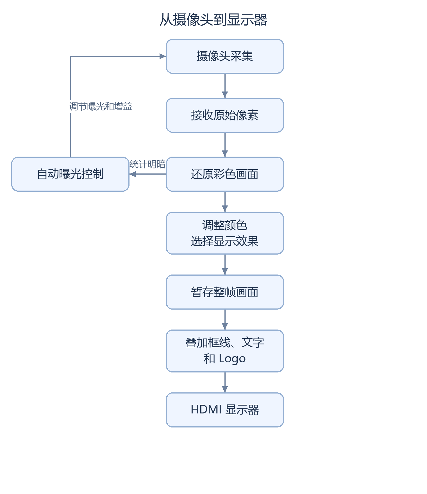

# 基于 HX1P35A 的摄像头实时图像处理

这个项目把摄像头拍到的画面送入 FPGA 开发板处理，再通过 HDMI 显示到屏幕上。可以按键切换彩色、黑白、黑白轮廓等效果，后续版本还加入了“安路”Logo 和红色区域框选。

这里的 FPGA 可以理解为一块能按设计并行处理数据的芯片。项目的重点是让视频持续经过这些处理环节，同时保持画面、行和帧的顺序正确。输出画面为 **1280 × 720**。

## 能看到什么

|功能|画面或操作效果|目前掌握的情况|
|---|---|---|
|摄像头显示|摄像头拍什么，显示器就显示什么|已有视频和开发者上板反馈；最终文件与现场加载记录仍需对应|
|四种显示模式|彩色；只有明暗的灰度；只有黑白两色的二值化；突出轮廓的 Sobel 边缘图|已有源码、仿真及历史演示；当前版本的完整板测记录待补|
|自动曝光（AE）|根据画面明暗调整摄像头曝光和增益|已集成，但室内仍可能偏暗|
|三种白平衡（AWB）|用 A/B/C 三种方案比较画面偏色情况|C 已有上板观察，与 A 接近，可能略好；偏色未解决|
|Logo 和运行信息|右上角显示“安路”图形，左上角显示调试信息|Logo 候选已有上板成功反馈，逐项验收待补|
|红色区域框选|用黄框和 `RED TARGET` 标出符合规则的红色区域|原版本有贴边扩框问题；修复版已完成工具检查并收到上板反馈，实际效果与长时间稳定性待补记录|

红色框选依据颜色规则工作，不能分辨“红苹果”和“红纸”。红色背景也可能被选中。

## 画面怎样到达屏幕



<details>
<summary>流程图的可编辑源码</summary>

图形由[生成脚本](scripts/render_doc_diagrams.py)中的 `video_overview` 定义绘制，中文字体在生成图片时固定，显示时不再重新测量文字宽度。修改步骤或文字后，可用 Pillow 重新生成。

</details>

框线、文字和 Logo 属于后续检测版本。自动曝光从白平衡之前的画面统计明暗；红色检测从白平衡之后、四种显示效果之前的彩色画面取样。因此切到灰度后，检测仍然依据原彩色数据工作。接线细节见[系统设计](docs/PROJECT_ANALYSIS.md)。

## 如何操作

|操作|结果|
|---|---|
|短按模式键|彩色 → 灰度 → 二值化 → Sobel 轮廓 → 彩色|
|长按约 1 秒|白平衡 A → B → C → A|
|复位|恢复彩色和 A；阶段演示使用 C 时，需要重新长按选到 C|

A 是原有白平衡算法；B 保持颜色通道原有增益，便于比较；C 根据完整画面的统计调整红、蓝通道。每次切换后至少等待 20 帧，建议等约 3 秒再比较。曝光、白平衡调节都有上限，并不能保证所有灯光下都足够亮或无偏色。

## 现在进行到哪里

仓库保留几个阶段的版本，方便比较和回退。**文件名中的 `stable` 表示稳定性修复候选，不代表已经通过最终稳定性验收。**

|版本|主要用途|应该看哪份记录|
|---|---|---|
|`frame_awb`|保留的阶段演示基线：四模式、自动曝光、A/B/C 白平衡|[阶段基线](docs/STAGE_BASELINE.md)；`release/current.json` 仍指向它|
|`logo_osd`|在基线上加入官方 Logo|[Logo 报告](docs/SC520CS_LOGO_OSD_REPORT.md)|
|`red_target`|加入红色框选；实际视频发现靠边时框突然变大|[原检测报告](docs/SC520CS_RED_TARGET_REPORT.md)|
|`red_stability`|改为筛选较集中的红色区域，减少远处红点把框拉大的情况|[修复报告](docs/SC520CS_RED_STABILITY_REPORT.md)|

截至 **2026-10-18 的现有记录**，开发者已反馈 `stable` 上板；现场加载文件的 SHA256（文件指纹）尚未独立核对。最新核查也确认：偏暗原因仍未确定，不能直接归因于官方初始化参数。详见[亮度核查](docs/SC520CS_BRIGHTNESS_BASELINE_AUDIT.md)。

**仍需补齐：**修复版贴边框选效果、各模式与按键的完整实物记录、20～30 分钟连续运行，以及写入 Flash 后脱离电脑的断电重启测试。这些项目没有记为通过。各阶段测试数据见[验证报告](docs/QA_REPORT.md)，比赛要求见[完成表](docs/CONTEST_CHECKLIST.md)。

## 从哪里开始读

|想了解什么|推荐入口|
|---|---|
|第一次接触这个项目，想按顺序学习|[阅读指南](docs/READING_GUIDE.md)|
|缩写和报告里的数值是什么意思|[术语与指标说明](docs/GLOSSARY.md)|
|每个模块负责什么，为什么需要缓存|[系统设计](docs/PROJECT_ANALYSIS.md)|
|做过什么测试，还有什么问题|[验证报告](docs/QA_REPORT.md)|
|如何运行检查或恢复完整工程|[构建与测试](docs/CURRENT_BUILD.md)、[依赖说明](docs/DEPENDENCIES.md)|
|拿到开发板后怎样记录测试|[板级测试记录](docs/BOARD_VALIDATION.md)|
|整理前的文件怎样找回|[归档与恢复](docs/CLEANUP_AND_RECOVERY.md)|

## 仓库内容与运行检查

公开仓库提供自研 Verilog 模块、测试程序、检查脚本和文档。完整摄像头工程还依赖厂商例程与 IP；这些材料尚未确认公开分发许可，保留在本地。**只克隆 GitHub 仓库，可以检查公开源码和运行相应模块测试，不能直接生成完整摄像头镜像。** bit 文件和原始演示视频也未公开。

```text
HX1P35A_Image/
├── README.md                         # 项目入口
├── docs/                             # 设计、报告、使用与测试说明
├── qa/sc520cs_frame_awb_trial_20261016/
│   └── rtl/custom/                   # 公开的阶段基线自研模块
├── sim/custom/                       # 公开模块测试
├── scripts/                          # 文件校验与测试脚本
└── release/                          # 版本、文件指纹与历史验证清单
```

后续候选的完整目录和详细日志保留在本地；文档中会用“本地证据”标明，不能把它们当作克隆后就有的文件。

在仓库根目录执行，需 Python 3.11 或以上：

```powershell
# 检查公开源码是否与阶段清单一致
python scripts/verify_current.py

# 运行阶段基线的模块测试；按本机安装位置调整工具路径
python scripts/test_current.py --iverilog-bin D:/iverilog/bin --full

# 仅在已有完整本地依赖时，检查依赖及选定 bit
python scripts/verify_current.py --local
```

这些脚本对应 `release/current.json` 中的 AWB 阶段基线，不是后续 `stable` 候选的完整验收入口。构建流程、工具版本和适用范围见[构建与测试](docs/CURRENT_BUILD.md)。

硬件为 HX1P35A / PH1P35MDG324，摄像头为 SC520CS，开发工具为 Tang Dynasty 6.2.168116。线缆方向、板卡版本和引脚应结合实物及原理图核对，现有资料中的不一致之处仍保留为待确认项。

<details>
<summary>保留的 AWB 阶段基线文件指纹（点击展开）</summary>

`sc520cs_frame_awb.bit` 为 1,789,539 字节，未公开。它与后续检测版本不同，详细来源见[阶段基线](docs/STAGE_BASELINE.md)。

```text
SHA256 794946D5664CA984C8033C62786BD026BE0DF223317D808743B6A2D367E83371
```

</details>
