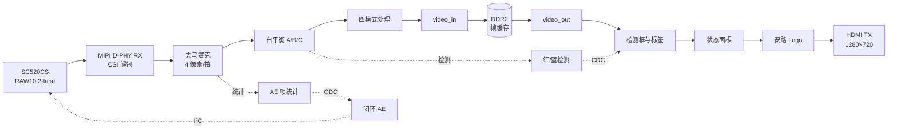

# 系统设计

本文说明最终版本（SHA-256 `A90F738A…`）的数据通路、时钟与复位，以及各自研模块的算法和接口。自研 RTL 位于 [hdl/](../hdl/)；顶层集成文件来自厂商例程，未公开，相关修改在文中说明。

## 数据通路



视频流在 MIPI 字节时钟域中以每拍 4 个像素（96 位 RGB888）处理，每行 320 拍。处理结果按 128 位字写入 DDR2，一帧 172,800 字；显示端在像素时钟域读出，依次叠加检测框、状态面板和 Logo，再送入 HDMI 发送器。叠加只修改显示输出，不写回 DDR，也不影响检测和 AE 统计。

## 时钟与复位

|时钟|频率|用途|
|---|---|---|
|`sys_clk_50m`|50 MHz|板载输入，PLL 参考|
|`MIPI_RX_BYTE_CLK`|103.5 MHz|CSI 解包、ISP、四模式处理、红蓝检测、DDR 写入侧|
|`pll_clk_24m`|23.81 MHz|摄像头主时钟、I²C 配置、AE 控制、按键|
|DDR2 用户时钟|133.3 MHz|DDR2 控制器用户接口|
|`HDMI_PIXEL_CLK`|75 MHz|显示时序（1650×750）、叠加、HDMI 编码|
|`HDMI_SERIAL_CLK`|375 MHz|TMDS 10:1 串行化|

跨时钟域的状态数据（AE 统计、红蓝检测结果、状态面板内容）都经 `custom_diag_snapshot_cdc` 信箱传递：源端保持全部数据位，直到往返确认完成，目标端两级采样后再分发。按键事件用翻转握手传到视频域，不传多位总线。

C7 拉低时复位 PLL，整个系统重新启动，包括摄像头上电时序和 I²C 寄存器配置。各时钟域在 PLL 锁定后分别同步释放复位；视频读写侧还要等 DDR2 校准完成（`init_calib_complete`）才释放。

## 自研模块

|模块|时钟域|功能|
|---|---|---|
|`custom_processing_top`|MIPI|四模式处理，在帧首提交模式|
|`custom_rgb_to_gray`|MIPI|灰度：(77R + 150G + 29B + 128) >> 8|
|`custom_sobel_4px`|MIPI|4 像素并行 3×3 Sobel，行缓存使用 ERAM|
|`custom_gray_threshold`|—|原二值化比较器；最终版本不再使用，综合时被优化掉|
|`custom_key_mode_request`|24 MHz → MIPI|按键消抖、短按/长按识别、跨时钟握手|
|`custom_frame_awb`|MIPI|白平衡 C：整帧灰度世界增益|
|`custom_awb_sof_aligner`|MIPI|把 AWB 的帧首对齐到第一个输出像素，并检查协议错误|
|`custom_ae_frame_stats`|MIPI|AE 帧统计，在 AWB 之前取数|
|`custom_closed_loop_ae`|24 MHz|闭环 AE，经 I²C 写曝光和增益|
|`custom_csi_sof_events`|MIPI → 24 MHz|帧事件传递，AE 用来确认新曝光已生效|
|`custom_red_detector`|MIPI|红色或蓝色区域检测（参数 `BLUE` 选择）|
|`custom_red_overlay`|像素|检测框和标签叠加|
|`custom_ae_overlay`|像素|左上角状态面板|
|`custom_diag_overlay`|像素|十六进制诊断面板，最终顶层未例化|
|`custom_diag_snapshot_cdc`|跨域|捆绑数据信箱|
|`custom_logo_overlay`|像素|安路 Logo 叠加，ROM 位于 ERAM|

### 四模式处理

`custom_processing_top` 同时计算四种结果，用两级寄存器对齐后选择输出，各模式延迟都是两拍。模式请求只在有效的帧首拍（`tvalid && tuser`）提交，所以切换不会出现半帧画面。Sobel 行缓存在所有模式下持续更新，切到 Sobel 或素描模式的第一帧即有完整历史。

|编码|模式|输出|
|---|---|---|
|`2'b00`|彩色|原 RGB|
|`2'b01`|灰度|三通道同为灰度值|
|`2'b10`|铅笔素描|见下|
|`2'b11`|Sobel|\|Gx\| + \|Gy\|，小于 48 置 0，大于 255 取 255|

铅笔素描用 Sobel 幅值画笔画，用灰度画阴影：

```
线条   = min(max(Sobel − 40, 0) × 2, 255)
素描值 = 255 − 线条 − (255 − 灰度) / 2        （小于 0 时取 0）
```

Sobel 的噪点门限 48 先去掉平坦区噪声；减去 40 后再放大，使略高于门限的残余噪声只画成浅灰，较强的边缘画成黑色。阴影使暗处呈灰色，不会大面积留白。参数为 `EDGE_CORE=40`、`EDGE_SHIFT=1`、`SHADE_SHIFT=1`。Sobel 窗口中心比当前像素滞后一行一像素，笔画相对阴影偏移 1 个像素，在 1280×720 下不可见。

`custom_key_mode_request` 的注释仍写着早期的“bypass, gray, binary, Sobel”顺序。编码 `2'b10` 现在对应铅笔素描；为保持源码与最终 bitstream 一致，未修改该注释。

### 按键

模式键 B9 低有效。在 23.81 MHz 下消抖 480,000 个周期（约 20 ms）：

- 短按在松开时生效，模式依次为彩色 → 灰度 → 铅笔素描 → Sobel → 彩色。
- 按住 1 秒时立即切换白平衡 A → B → C → A，并取消这次松开的短按事件，避免同时切换模式。

### 自动曝光

`custom_ae_frame_stats` 在 AWB 之前统计每帧的平均亮度（画面中央四分之一区域权重为 4）、饱和像素比例、白色和高亮像素比例。统计结果经信箱送到 24 MHz 域，由 `custom_closed_loop_ae` 决定调节方向：

- 目标亮度 112，容差 ±12；曝光范围 4～1991 行，增益上限 176。
- 采用室内主体优先策略：画面中只有一小块亮背景时，不阻止调亮；大面积多通道高亮只影响目标区间的上半部分。
- 每次只发出一组 I²C 写操作，等新曝光生效的帧事件到达后才进行下一次判断，不使用旧帧的统计结果。

暗室中 AE 常停在曝光 1991、增益 176 的上限，状态面板显示为 `REQ 07C7 G 00B0`，这是正常的稳态。

### 白平衡

|分支|方法|
|---|---|
|A|原 ISP 白平衡|
|B|单位增益，作对照|
|C|`custom_frame_awb`：整帧灰度世界。只统计各通道在 16～239 之间、且色彩比例不超过 4:1 的像素，增益限制在 0.5～2.0，下一帧生效|

C 分支复用原 AWB 的乘法器输入，不增加流水延迟。

### 红、蓝目标检测

`custom_red_detector` 与四模式处理并行读取白平衡后的 RGB，不修改视频流。

1. **像素判定。** 红色：R ≥ 96、R − G ≥ 48、R − B ≥ 48，室内模式还要求 2R ≥ 3G。蓝色：B 通道相对占优，并与其他通道有足够的绝对差，排除青色和灰色。
2. **区块统计。** 画面分成 32×32 像素区块，统计每块的命中数。红色区块命中数达到 128 进入、低于 96 退出；蓝色为 96 和 72。迟滞避免边界闪烁。
3. **区域选择。** 按行连接相邻的有效区块，选出主导区域，要求宽和高都至少 32 像素。
4. **帧间确认。** 连续 3 帧检出才显示，连续 2 帧未检出才撤销。

检测结果经信箱送到像素域，在场同步上升沿整包生效。红框和 `RED TARGET` 为黄色（`#FFEF00`），蓝框和 `BLUE TARGET` 为天蓝色（`#00BFFF`）；标签位于 (192,16) 和 (192,40)，绘制时避开状态面板和 Logo。结果超过 4 帧未更新就清除，不显示过期的框。

### OSD

- **状态面板：** 左上角 13 行，显示 AE 的平均亮度和饱和度、请求与已完成的曝光增益、AWB 分支和三通道增益。
- **安路 Logo：** 右上角 (1088,16)，160×160，使用官方例程的 Logo 位图。不透明像素都在第 34～127 行，ROM 只存这 94 行（15040 字 × 25 位，含 alpha），放在 19 块 ERAM 中，读出为一拍寄存。Logo 数据不随仓库发布，用 `scripts/make_logo_rom.py` 从官方文件生成。

## 厂商派生文件中的修改

完整工程基于安路 SC520CS Lab1 例程。以下文件经过修改，但含厂商代码，未公开；每个文件的 SHA-256 见 [release/final.json](../release/final.json)。

|文件|主要修改|
|---|---|
|`design_top_wrapper.v`|例化全部自研模块；复位域划分与 DDR 就绪保护；相机上电时序；HDMI 重同步计数器|
|`isp/isp_top.v`|白平衡 A/B/C 选择、AE 统计、红蓝检测、四模式处理接入|
|`isp/uial2axis.v`|帧首保护，避免启动时把不完整的帧当作新帧|
|`video_in.v`、`video_out.v`|摄像头/DDR/显示侧复位拆分（`SPLIT_RESET`）；复位前残留的帧首、场同步电平不当作新帧；读侧按已发出未返回的读请求预留 FIFO 空间；写侧按完整突发仲裁，避免长期阻塞读取|
|`mc_to_user_interface.v`|DDR 用户接口握手：写数据先于写地址提交，VALID 不等待自身 READY，保持事务顺序|
|`hdmi_tx.v`|新增 `I_tmds_blank`，为 1 时四路 TMDS（含时钟）输出 0|

HDMI 重同步：像素复位释放 2.0 秒后，四路 TMDS 停发 1.5 秒，再恢复输出。它原本用于模拟插拔 HDMI 线，以消除启动闪烁，但上板未能消除闪烁（见 [开发记录](HISTORY.md#启动闪烁)）。这段逻辑对正常显示没有影响，保留在最终版本中。仓库中的 [tb/tb_hdmi_resync.v](../tb/tb_hdmi_resync.v) 包含与顶层逐行相同的摘录。
