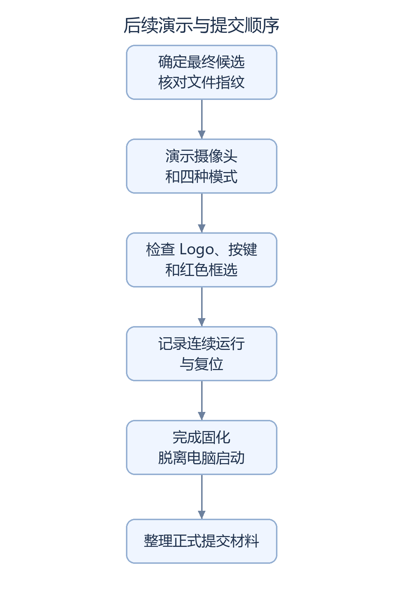

# 比赛要求与完成情况对照

赛题要求在 HX1P35A 上完成至少 **3 项基础要求和 1 项扩展要求**，全部功能集成于同一个配置文件，固化后能脱离电脑上电运行。已有实现和阶段证据见下表；最终逐项板测尚未完成，暂不统计已通过的比赛条目数。

## 当前完成情况

|要求|验收内容|截至 2026-10-19 的记录|待完成验证|
|---|---|---|---|
|采集并显示|摄像头画面能通过 HDMI 输出|已有实现、历史视频和上板反馈|确认最终文件与现场视频对应|
|图像算法|画面在 FPGA 中经过处理|已实现灰度、二值化和 Sobel 边缘检测|在最终版本中逐模式演示|
|连续稳定显示|长时间不黑屏、不花屏、不停止|有短时观察，完整验收未完成|记录 20～30 分钟及切换、复位情况|
|叠加图形与 Logo|输出包含规定的安路图形标志|Logo 已实现并有上板反馈|检查各模式、透明区与持续运行|
|扩展功能|选一项扩展并给出效果证明|已实现红色区域检测；稳定性修复及暗红后继按候选分别验证|对照测试贴边、多红区和照明变化|
|一个最终文件|演示所有功能时不用反复换设计|后续检测候选已集成这些功能|连续演示并记录该文件的 SHA-256|
|脱离电脑启动|断电再上电能自行恢复运行|尚未验证|另行完成 Flash 固化与冷启动|
|提交材料|符合官方材料清单和命名要求|已有工程及验证说明|正式清单、命名和截止日期仍待补|

红色区域检测的实现证据不等同于物体类别识别。比赛扩展项的最终认定需结合指定候选的板级结果和评审要求。

## 验收顺序

流程图的可编辑源码

图形来源：[生成脚本](../scripts/render_doc_diagrams.py)中的 `contest_steps` 定义；使用 Pillow 和固定中文字体生成。

2026-10-18 的[亮度核查](SC520CS_BRIGHTNESS_BASELINE_AUDIT.md)已记录 `stable` 上板反馈，但现场文件指纹、修复效果和连续运行记录尚不完整。2026-10-19 [暗红后继](SC520CS_DARK_RED_REPORT.md)具有独立工具证据，尚未完成板级验证，不替代 AWB 阶段发布基线。下方表格保留 2026-10-17 的逐项来源和当时状态；P0/P1/P2/P3 依次表示更靠前到更靠后的工作优先级，不是比赛得分。

## 赛题来源与逐项证据

赛题依据为本地原始 `docs/reference/赛题解析二 .pptx`：第 5 页基础要求、第 6 页扩展要求、第 26 页提交限制；第 12、18 页为官方例程及 OSD 思路。原文件 SHA-256：`80A35371A96A6DD7F9745432E575FA9B4D7DC09409E180DA934F0149C1A1E061`。原始逐页提取保存在基线目录 `contest_requirements_extract_20261017.json`，不修改原件。

第 26 页说明不按资源大小评测，因此 LUT 降低不能单独算作扩展完成。项目内尚未定位独立提交材料清单、命名规范和截止日期文件，提交前需补齐这些信息。

状态仅使用 pass / fail / not tested，并在同一行限定证据范围；没有统计竞赛已通过条目数。

|要求|现有实现及状态|实物证据|剩余工作|优先级|
|---|---|---|---|---|
|指定 HX1P35A 平台（5、26 页）|pass（工程范围）：PH1P35MDG324，见 current.json 和 .al|历史演示及开发者板测反馈；最终验收还需可辨识板卡照片|提交时补板卡、连线全景|P1|
|基础1：MIPI 采集→HDMI（5 页）|pass（源码/既有构建范围）：SC520CS RAW10→ISP→DDR→HDMI|历史四模式视频、C 上板反馈；当时现场加载 SHA-256 未独立绑定|补拟验收镜像 SHA-256 和连续实拍|P0|
|基础2：至少一种 FPGA 算法（5 页）|pass（源码/历史仿真范围）：灰度、二值化、Sobel 边缘检测，见 QA_REPORT|历史四模式视频，早于 AWB 阶段基线|拟验收镜像逐模式实拍，不重复构建|P0|
|基础3：处理后连续稳定显示（5 页）|not tested（完整板级验收）：已有短时观察|历史视频及开发者反馈不能证明 20～30 分钟|板级测试负责人完成连续运行稳定性、切换、复位记录|P0|
|基础4：OSD 且含“安路”Logo（5、18 页）|pass（独立 Logo 候选源码/自检/工具构建范围）：官方位图、DDR 后叠加，面板保留；见 [Logo 报告](SC520CS_LOGO_OSD_REPORT.md)|已记录开发者对 Logo 基线上板成功的反馈；现场加载 SHA-256 未独立绑定；新检测候选实物待测|板级测试负责人按候选 SHA-256 进行 SRAM 验证；四模式下辨认 Logo、透明区及面板，完成切换/复位/连续运行稳定性|P1，实物待测|
|扩展：风格化/增强（6 页第1项）|not tested（竞赛扩展验收）：AE/AWB 已有，阶段演示接受轻微偏色限制；Sobel 边缘检测属于基础算法，暂不重复计分|A/B/A 视频及 C 反馈不构成完整扩展证明|暂停调参；如选此项需明确新增效果与对照验收|P2，备选|
|扩展：简单目标识别+结果/文字（6 页第2项）|pass（源码/仿真/建模构建）：独立红色区域稳定性候选，密块区域筛选框与 RED TARGET；不宣称物体类别识别，见[修复报告](SC520CS_RED_STABILITY_REPORT.md)|原红色候选已有上板反馈，视频发现贴边包围框异常扩展；修复候选not tested，20分钟待板级测试负责人补充记录|按候选 SHA-256 执行 SRAM验证贴边/部分出画/远处红点/多区域取舍/曝光变化、四模式、A/B/C及复位恢复|P1，实物待测|
|扩展：外部控制/性能/创意（6 页第3～5项）|not tested：既有优化记录不代表实测性能收益或完整应用|无对应量化板测证据|仅需扩展至少1项；不列为该阶段并行开发项|P3，备选|
|一个最终集成镜像（26 页）|pass（源码范围）：检测候选已在同一 checked bitstream 集成四模式、AE、A/B/C、官方 Logo、颜色区域框/文字|缺最终全部功能单镜像视频|验证新检测候选，并用绑定 SHA-256 的连续视频证明全部功能不换镜像|P1|
|固化、无PC上电（26 页）|not tested|无|由板级测试负责人在最终验证阶段执行 Flash 固化与断电冷启动；2026-10-17 构建阶段未执行|P1，发布门槛|
|提交材料、可复现与限制|pass（2026-10-17 文档范围）：源码清单、依赖 SHA-256、bitstream SHA-256、构建与QA记录；公开仓库不含受限IP，不能独立构建|实物视频本地保留，见 STAGE_BASELINE|补正式提交细则、最终演示和测试结果；GitHub 发布不等同于比赛正式提交|P1|

## 原红色检测候选构建历史

2026-10-17 已记录 Logo 基线上板成功的反馈；该阶段独立 `qa/sc520cs_red_target_trial_20261017` 完成红色区域检测、跨帧确认、包围框与 RED TARGET、clean 综合、布局布线、约束复核及 checked bitgen。最终 setup/hold 为 +0.008/+0.020 ns，覆盖 98.91%；8 ps 裕量很小，仅记建模检查通过。灰码 36/36 仍为 7.2 ns，新 51 位邮箱为 12 ns，未放宽原时钟或预算。

镜像：`run_bitgen_red_checked/sc520cs_red_target.bit`，SHA-256 `7EBEC0062FF9966BEE76C043D831031FC9B09AD24DB62E0C34F08D781E289FFE`。源、bitstream、失败轮次、测试与资源证据见[检测功能报告](SC520CS_RED_TARGET_REPORT.md)。release/current.json 仍保留原阶段基线，原候选/成功 bitstream 均保留。

以上为原红色候选生成时记录。随后开发者反馈原红色候选已上板，并提供包围框异常扩展视频；中央区域可检测的观察不证明边界稳定或20分钟连续运行通过。该阶段后续板测对象转为稳定性修复候选，按其 SHA-256 区分；当时暂停 AE/AWB 调参，未执行硬件下载或 Flash 写入。

## 红色检测后续稳定性修复

原算法的贴边异常由现场视频确认。独立修复候选完成密度区域筛选、短迟滞、相关回归和重新构建，保留原候选、成功 bitstream 与失败证据。文件指纹、时序和资源见[稳定性报告](SC520CS_RED_STABILITY_REPORT.md)。2026-10-17 构建完成时，实物、20 分钟和固化验收均为 `not tested`，该阶段未下载或写 Flash；2026-10-18 的上板反馈另行登记，完整验收仍待补。
