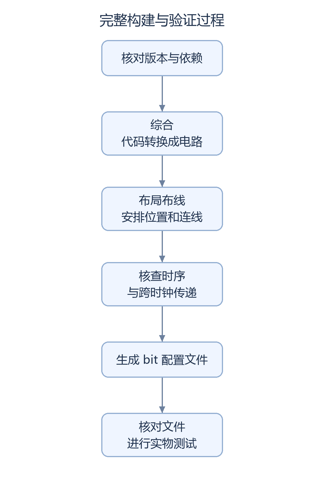

# 构建与测试方法

先区分“检查文件”“运行仿真”和“生成 FPGA 配置文件”。只阅读项目或验证公开模块，无需运行完整构建。以下常用脚本固定检查 AWB 阶段基线，后续 Logo 和检测候选按各专项报告追溯。

## 根据手头材料选择步骤

|手头有什么|可以做什么|入口|
|---|---|---|
|只克隆公开仓库|检查公开源文件；安装仿真工具后运行模块测试|下面两条命令|
|完整本地依赖与选定 bit|进一步核对工程、厂商依赖和文件指纹|`python scripts/verify_current.py --local`|
|完整本地工程与 TD 工具|按独立候选的流程综合、布线并生成新 bit|展开的工程步骤；先看版本绑定限制|
|真实开发板|记录画面、切换、复位和持续运行|[板级测试](BOARD_VALIDATION.md)|

```powershell
# 在仓库根目录执行；Python 3.11 或以上
python scripts/verify_current.py

# 仿真工具路径按本机实际安装位置填写
python scripts/test_current.py --iverilog-bin D:/iverilog/bin --full
```

第一条只检查公开清单，缺少的受限依赖会跳过；第二条测试 AWB、按键、状态同步、曝光和四模式等模块。输出保存在 `build/current_tests/时间戳/`，不是上板视频。仿真工具也可通过 `IVERILOG_BIN` 或 `PATH` 指定。

## 完整构建经过什么



<details>
<summary>流程图的可编辑源码</summary>

图形由[生成脚本](../scripts/render_doc_diagrams.py)中的 `build_steps` 定义绘制，中文字体在生成图片时固定，显示时不再重新测量文字宽度。修改步骤或文字后，可用 Pillow 重新生成。

</details>

任一步失败都需保留报告。工具退出码为 0 只说明程序结束正常，还要看时序、告警和实际输出。生成 bit 不会自动证明开发板运行正常。

## 版本与使用条件

阶段基线位于 `qa/sc520cs_frame_awb_trial_20261016`，完整工程入口为其中的 `lab_ex1_mipi_hdmi/td_project/camera_to_dsi_display.al`，顶层为 `design_top_wrapper`。硬件器件 PH1P35MDG324、Speed -3；开发工具 Tang Dynasty 6.2.168116。公开模块测试使用 Icarus Verilog，已有记录版本为 12.0(devel)；部分候选使用 ModelSim 2020.3。

只取得官方例程不一定能复现当前文件；还需要对应的本地修订及精确依赖，见[依赖说明](DEPENDENCIES.md)。下方构建命令包含历史运行名，已有输出不能覆盖；复现需建立独立候选并更新测试与源码对应关系。`--local` 只是校验现有文件，不执行综合、下载或 Flash 写入。


<details>
<summary>AWB 基线工程命令、约束与历史文件绑定（点击展开）</summary>

## 工程与环境

当前集成工程为：

```text
qa/sc520cs_frame_awb_trial_20261016/
└─ lab_ex1_mipi_hdmi/td_project/camera_to_dsi_display.al
```

顶层模块 `design_top_wrapper`，目标器件 PH1P35MDG324、Speed -3，开发工具 Tang Dynasty 6.2.168116。工程沿用候选原有相对路径。`project/` 中的 SC500CS 工程及其他 QA 候选仅用于历史追溯。

公开仓库包含自研模块和必要测试。完整工程需要先恢复本地依赖，具体见[依赖说明](DEPENDENCIES.md)。

## 文件校验与 RTL 回归

在仓库根目录执行，Python 版本须为 3.11 或以上：

```powershell
python scripts/verify_current.py
python scripts/test_current.py --iverilog-bin D:/iverilog/bin --full
```

第一条命令校验公开源文件；第二条运行小帧及完整帧 AWB、按键、状态 CDC、室内 AE 和四模式测试。仿真工具路径可通过 `--iverilog-bin`、`IVERILOG_BIN` 或 `PATH` 设置。测试输出写入 `build/current_tests/时间戳/`，保留历次结果。

完整本地依赖恢复后执行：

```powershell
python scripts/verify_current.py --local
```

该检查包含工程依赖和选定 bit。仅克隆公开仓库时，会报告未提供的本地依赖；公开模块回归仍可独立运行。

## TD 构建流程

现有 bit 对应以下构建记录：

```text
syn_6 → run_route_11_gray_csa → final 时序与 CDC 查询
      → run_bitgen_frame_awb_checked
```

原始命令、Tcl、日志和输入哈希均保存在本地候选目录。2026-10-16 的仓库整理完成了源绑定复核，未重新执行 TD 构建。

恢复依赖后，可按以下顺序启动新的综合、实现和查询任务。以下名称仅为示例，执行前须确认输出目录尚不存在：

```powershell
$q='qa/sc520cs_frame_awb_trial_20261016'
& "$q/run_opt_gate.ps1" -RunName syn_20
& "$q/run_implement.ps1" -RunName run_route_rebuild_20 -SynRun syn_20
& "$q/run_current_audit.ps1" -Route run_route_rebuild_20 -Prefix rebuild_20
```

综合脚本依赖前驱目录中的 `qa/sc520cs_ddr_100mhz_diff_trial/run_internal_pll_opt_gate.ps1`。实现脚本显式清除并加载 QA 时钟、DDR、I2C、AE 和 FIFO 约束；GUI 默认构建未必加载相同约束。引脚、工程默认 SDC 和 IP 配置均记录在源清单中。

时序查询脚本依据实际实现网表追踪 packed 引脚名称。重新实现后，名称或结构可能发生变化；若保护检查失败，应重新确认对应逻辑与例外范围，再继续生成 bit。

### bit 生成与版本绑定

历史 `freeze_diag_sources.py` 固定绑定 `syn_6`。`run_closed_ae_bitgen.ps1` 还校验冻结输入、测试证据、旧候选及原有四个暂存路径，其默认参数属于历史前驱。生成新版本前，须在独立 QA 副本中更新相应绑定并重新验证。

现有 bit 的生成命令记录如下，仅用于追溯：

```powershell
& "$q/run_closed_ae_bitgen.ps1" -RouteName run_route_11_gray_csa -AuditPrefix final -BitgenRun run_bitgen_frame_awb_checked
```

对应输出已经存在，脚本会拒绝覆盖。该命令不能直接作为新网表的自动发布步骤。`scripts/verify_current.py --local` 用于核对现有成果，不执行综合或实现。

## 手动板测

按板型、相机、线缆方向及官方流程核对连接，确认 bit 大小和 SHA 后，再进行受控 SRAM 加载。按键操作为：

|操作|功能|
|---|---|
|短按|彩色 → 灰度 → 二值化 → Sobel|
|长按约 1 秒|A 原 AWB → B 单位增益 → C 完整帧 AWB|

长按释放不会附带短按事件。建议固定照明和相机位置进行 A/B/C/A 对照，每次切换后至少等待 20 帧，记录曝光、分支、增益及异常状态。已有观察见[板级测试记录](BOARD_VALIDATION.md)。

Flash 独立启动需另行安排写入及断电测试；现有记录尚不包含该项验证。

</details>
