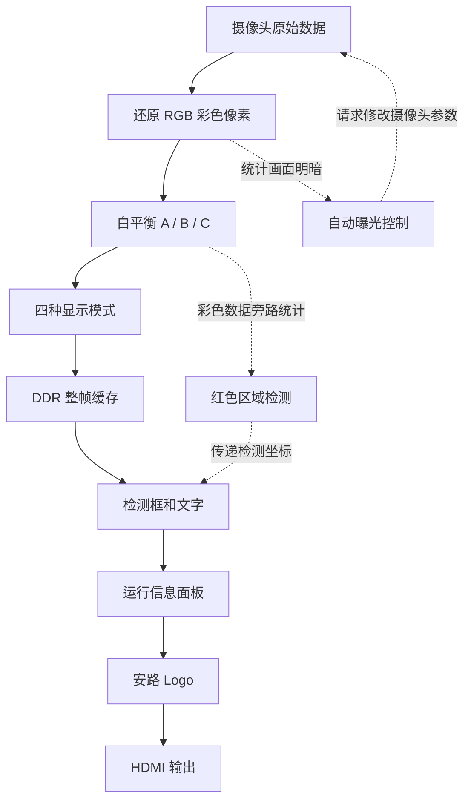

# 系统设计：画面如何经过 FPGA

系统分为采集、图像处理、整帧缓存和显示四部分。下面先解释各部分的作用；接口位宽、文件位置和时钟数据放在文末，便于需要改代码时查阅。

## 每个环节负责什么

|环节|它做的事|为什么需要|
|---|---|---|
|摄像头接收|按 MIPI 协议取回原始像素，识别行和帧|确认数据顺序和画面边界|
|颜色还原|把传感器的颜色采样还原为红、绿、蓝|原始采样不能直接当作完整彩色点显示|
|白平衡与四模式处理|调整颜色比例，再选择彩色、灰度、二值化或轮廓|让同一套输入产生不同显示效果|
|整帧缓存|先写入 DDR，再按显示端节奏读出|摄像头和屏幕使用不同节奏，不能假设总能同时读写|
|画面叠加|加上运行信息、Logo 和检测结果|让观察者看到算法结果与调试状态|



检测框和 Logo 属于后续候选。原 AWB 阶段基线只有运行信息叠加，未包含这些新增功能。红色检测在四模式之前读取彩色数据，显示端再叠框；检测坐标还没有与 DDR 中的具体帧绑定，所以移动时可能看到框有延迟。

## 为什么切换模式要等到下一帧

一帧是一整张图。如果按键一来就立刻改算法，同一张图的上下部分可能采用不同模式。工程先记住请求，再在有效帧开始时应用；按键还会先去除机械抖动，区分短按和长按。

## 为什么要同步传递坐标和状态

摄像头处理、缓存和显示使用不同的时钟。工程先保存一整份坐标，再通过请求与确认传给显示端，在显示帧开始时一起更新。这样可以避免四个边界属于不同次结果。状态面板可能跳过中间更新，不能当作逐帧连续测量仪表。

## 版本与待解决问题

下面的详细接口以 `release/current.json` 中的 **AWB 阶段基线**为对象。Logo、原红色检测、稳定性修复的实际变化分别见各专项报告。2026-10-18 的亮度核查已有 `stable` 上板反馈；全功能、长时间运行和独立启动记录仍待补。旧文中“下一项为 Logo”是当时计划，不是最新进展。

历史上已发现无间隙帧首条件下 FIFO 可能丢数据的反例；后续检测测试通过并未证明该问题也已修复。详见[验证报告](QA_REPORT.md)。缩写可查[术语表](GLOSSARY.md)。


<details>
<summary>AWB 阶段基线的接口、时钟与历史核验记录（点击展开）</summary>

## 版本依据

当前集成候选为 `qa/sc520cs_frame_awb_trial_20261016`，包含室内 AE、四种显示模式和 AWB A/B/C。版本选择依据为实际工程清单、`syn_6` 原生源清单及对应构建记录。该候选具备完整的构建证据，但尚未完成色度与长期稳定性验证。

工程入口、器件及 bit 信息见 [current.json](../release/current.json)；全部工程条目见 [active_sources.csv](../release/active_sources.csv)。

## 视频通路

```text
MIPI D-PHY → CSI / RAW10 解包 → uial2axis
    → demosaic → data128_96 → AWB A/B/C → 四模式处理
    → data_96bit_to_128bit → video_in → FIFO / DDR
    → video_out → 状态叠加 → HDMI
```

AE 从 `data128_96` 输出、AWB 之前旁路采样。以下路径均相对于候选根目录；为便于阅读，`hdl/` 表示 `lab_ex1_mipi_hdmi/user_source/hdl_source/`。

|环节|接口与时序|源码位置|
|---|---|---|
|摄像头至 ISP|2 lane RAW10；ISP 输入 `I_tdata[39:0]` 及 valid、user、last 标记，工作于 CSI 域|`hdl/design_top_wrapper.v:649–769`；`hdl/isp/isp_top.v:1–21`|
|去马赛克与 AE 测光|96 bit RGB 流，每拍 4 个 RGB888 像素；首像素为 `[95:72]`，单像素 R/G/B 对应 `[23:16]`、`[15:8]`、`[7:0]`|`hdl/isp/isp_top.v:102–139`；`rtl/custom/custom_ae_frame_stats.v`|
|白平衡与模式处理|三个 AWB 分支同沿输出；提前 SOF 经对齐处理。四模式统一采用两拍标记延迟，每行 320 个有效输入拍|`hdl/awb.v`；`hdl/isp/isp_top.v:132–187`；`rtl/custom/custom_frame_awb.v`|
|重打包与帧缓存|96 bit 转为 128 bit，每行 320 拍转换为 240 字，共 720 行；经 FIFO 从 CSI 域进入 DDR 用户域|`hdl/isp/isp_top.v:171–200`；`hdl/design_top_wrapper.v:792–828`|
|视频读出与显示|DDR 用户域至 HDMI 域；状态面板的 RGB、DE、HS、VS 延迟已有分层检查|`hdl/design_top_wrapper.v:829` 起；`rtl/custom/custom_ae_overlay.v`|

该链路未提供任意反压条件下的无损保证。历史无间隙 SOF 反例及异常帧恢复限制见 [QA 报告](QA_REPORT.md)。活动 AWB 为 `hdl/awb.v`，实际编译关系以工程清单为准。

## 控制与跨时钟域通信

按键为低有效输入，在 CAM 域完成消抖和长短按识别，通过事件握手传至 CSI 域；短按切换四模式，长按切换 A/B/C。处理器在有效帧首应用模式请求。相关接线见 `hdl/design_top_wrapper.v:762–785` 和 `rtl/custom/custom_key_mode_request.v`。

AE/AWB 状态通过相干 mailbox 传递：CSI → CAM 数据包为 226 bit，其中低 160 bit 保留室内 AE 数据；CAM → HDMI 使用既有 468 bit 数据包。快照可能合并中间状态，面板读数不等同于逐帧遥测。相关逻辑见 `hdl/isp/isp_top.v:59–63`、顶层 snapshot 接线及 `custom_diag_snapshot_cdc.v`。

## 时钟与约束

|时钟域|频率|周期|
|---|---:|---:|
|系统输入|50 MHz|20 ns|
|CSI|103.520 MHz|9.660 ns|
|DDR 用户时钟|133.333 MHz|7.5 ns|
|CAM|23.809524 MHz|42 ns|
|HDMI 像素时钟|75.002 MHz|13.333 ns|

实际构建加载 `constraints/base_clocks.sdc`、`constraints/ddr_clock_relations_audit.sdc`、`i2c_clock.sdc`、`top_clock_relations_ae.sdc` 及 FIFO 生成 Tcl；查询阶段另加载 `diag_entries.sdc`。引脚文件为工程清单中的 `user_source/constraints_source/pin.adc`。

复位、PLL 锁定和 DDR-ready 链沿用当前候选。2026-10-16 的整理未修改时钟周期、时序例外、引脚或复位逻辑。

## 清单核验与待完成工作

工程包含 70 条文件记录，其中 6 条标记为 `AutoExcluded`。核验结果为：全部路径存在，394 项输入及依赖哈希匹配；显式活动 Verilog 文件解析得到 56 个模块名，未发现重复定义。加密及生成 IP 的展开关系仍以 TD 原生清单和既有 elaboration 记录为依据。

原 8 组回归的 105 项编译源绑定通过复核，当前灰度模块与全 RGB 穷举证书所对应的源文件一致。

2026-10-17 用户接受室内亮度与轻微偏色，暂停 AE/AWB 画质优化。后续重点是加载文件 SHA 确认、全模式板测、20～30 分钟持续运行与反复切换，以及外部时序和硬 PHY 验证。下一项比赛功能为“安路”Logo OSD，见[逐项完成表](CONTEST_CHECKLIST.md)。Flash 冷启动需另行安排。旧 SC500CS 基线和官方 lab_ex_1/2/3 保留在本地 `vendor/`、`project/`，用于历史追溯。

</details>
