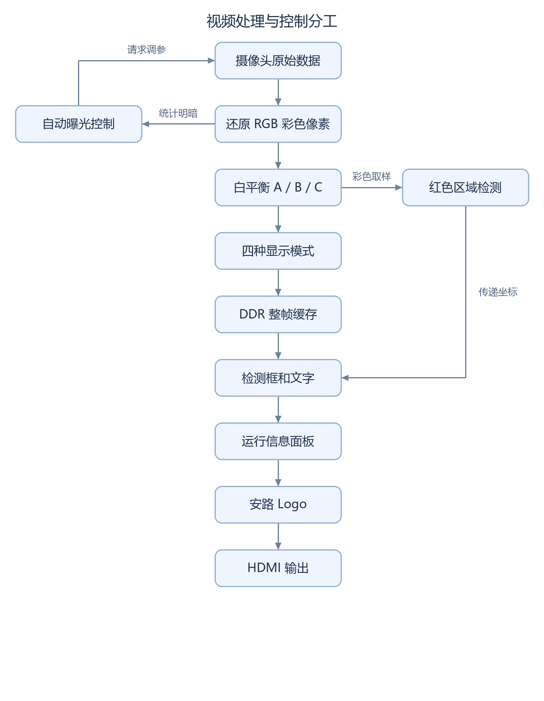

# 系统架构与模块接口

系统由摄像头接收、图像信号处理（ISP）、DDR 帧缓存和 HDMI 输出组成。接口说明以 AWB 阶段基线为基础，后续候选的检测和 OSD 接入差异分别说明。

## 模块职责

|模块|职责|接口作用|
|---|---|---|
|摄像头接收|按 MIPI 协议取回原始像素，识别行和帧|确认数据顺序和画面边界|
|颜色还原|把传感器的颜色采样还原为红、绿、蓝|将颜色滤波阵列采样转换为 RGB 像素|
|白平衡与四模式处理|调整颜色比例，再选择彩色、灰度、二值化或 Sobel 边缘检测|让同一套输入产生不同显示效果|
|整帧缓存|先写入 DDR，再按显示端节奏读出|协调采集与显示时钟域的数据速率|
|画面叠加|加上运行信息、Logo 和检测结果|输出检测结果与运行状态|



## 后续候选接口核对

2026-10-19 只读核对稳定性修复候选的实际连接，确认检测统计位于四模式处理之前，显示叠加位于 DDR 读出之后。下表路径相对于 `qa/sc520cs_red_stability_trial_20261017/lab_ex1_mipi_hdmi/user_source/hdl_source/`；原表中的行号仍适用于 AWB 阶段基线。

|源 → 目的|接口与时钟域|实现位置|
|---|---|---|
|AWB 选择输出 → 检测器|96 位 RGB888，每拍 4 像素；有效、帧首与行尾标记；CSI 域|`isp/isp_top.v:171–176`，`u_red_detector`|
|AWB 选择输出 → 四模式处理|同一彩色流并行送入处理模块；CSI 域|`isp/isp_top.v:178–190`，`u_custom_processing_top`|
|检测结果 → CDC 邮箱 → 显示叠加|57 位逻辑数据包；CSI → HDMI 像素域，显示 VS 成组更新|`design_top_wrapper.v:980–990`，`u_red_cdc`、`u_red_overlay`|
|检测叠加 → 状态面板 → Logo → HDMI|RGB、DE、HS、VS 同步延迟；HDMI 像素域|`design_top_wrapper.v:992–1008`，`u_diag_overlay`、`u_logo_overlay`|
|独立参考时钟 → DDR|`S_100m_clk` 接 `I_ddr_ref_clk`|`design_top_wrapper.v:885`|

稳定性候选视频数据路径未因检测统计新增延迟；检测框叠加保持 1 个像素寄存级，诊断面板和 Logo 各为 3 级。2026-10-19 暗红后继保持相同接口，仅调整检测最低 R 门槛；差异来源见[暗红报告](SC520CS_DARK_RED_REPORT.md)。以上为源码连接核对，不代替硬件测量。

<details>
<summary>流程图的可编辑源码</summary>

图形来源：[生成脚本](../scripts/render_doc_diagrams.py)中的 `system_design` 定义；使用 Pillow 和固定中文字体生成。

</details>

AWB 阶段基线包含运行信息叠加；Logo 和检测框分别在后续候选中接入。检测模块从 AWB 输出、四模式选择之前的 RGB 数据统计区域分布；包围框在 DDR 读出后的 HDMI 像素域叠加。检测元数据未绑定 DDR 帧槽，因此不能保证坐标与显示帧精确对应。

## 帧边界控制

按键模块完成消抖及长短按识别后提交模式请求。处理模块在有效帧首应用请求，防止同一帧中途切换算法。短按切换彩色、灰度、二值化和 Sobel 边缘检测；长按切换 A/B/C 白平衡方案。

## 跨时钟域传递与状态一致性

摄像头处理、DDR 用户接口和 HDMI 显示工作于不同的时钟域。坐标通过保持数据及请求/应答握手成组传递，在显示帧首原子更新，避免边界字段跨版本混合。状态快照允许合并中间更新，不构成逐帧遥测。

## 版本适用范围与验证边界

下列详细接口对应 `release/current.json` 中的 **AWB 阶段基线**。Logo、原红色检测、稳定性修复和 2026-10-19 暗红后继分别按专项报告追溯。2026-10-18 已记录 `stable` 上板反馈；现场加载 SHA-256、完整功能、持续运行和独立启动验收尚不完整。

历史上已发现无间隙帧首条件下 FIFO 可能丢数据的反例；后续检测测试通过并未证明该问题也已修复。详见[验证报告](QA_REPORT.md)。缩写可查[术语表](GLOSSARY.md)。


<details>
<summary>AWB 阶段基线的接口、时钟与历史核验记录</summary>

## 版本依据

2026-10-16 接口核验对象为 `qa/sc520cs_frame_awb_trial_20261016`，包含室内 AE、四种显示模式和 AWB A/B/C。版本选择依据为实际工程清单、`syn_6` 原生源清单及对应构建记录。该候选具备完整的构建证据，但尚未完成色度与长期稳定性验证。

工程入口、器件及 bitstream 信息见 [current.json](../release/current.json)；全部工程条目见 [active_sources.csv](../release/active_sources.csv)。

## 视频通路

```text
MIPI D-PHY → CSI / RAW10 解包 → uial2axis
    → demosaic → data128_96 → AWB A/B/C → 四模式处理
    → data_96bit_to_128bit → video_in → FIFO / DDR
    → video_out → 状态叠加 → HDMI
```

AE 从 `data128_96` 输出、AWB 之前旁路采样。以下路径均相对于候选根目录；为便于阅读，`hdl/` 表示 `lab_ex1_mipi_hdmi/user_source/hdl_source/`。

|环节|接口与时序|源码位置|
|---|---|---|
|摄像头至 ISP|2 lane RAW10；ISP 输入 `I_tdata[39:0]` 及 valid、user、last 标记，工作于 CSI 域|`hdl/design_top_wrapper.v:649–769`；`hdl/isp/isp_top.v:1–21`|
|去马赛克与 AE 测光|96 bit RGB 流，每拍 4 个 RGB888 像素；首像素为 `[95:72]`，单像素 R/G/B 对应 `[23:16]`、`[15:8]`、`[7:0]`|`hdl/isp/isp_top.v:102–139`；`rtl/custom/custom_ae_frame_stats.v`|
|白平衡与模式处理|三个 AWB 分支同沿输出；提前 SOF 经对齐处理。四模式统一采用两拍标记延迟，每行 320 个有效输入拍|`hdl/awb.v`；`hdl/isp/isp_top.v:132–187`；`rtl/custom/custom_frame_awb.v`|
|重打包与帧缓存|96 bit 转为 128 bit，每行 320 拍转换为 240 字，共 720 行；经 FIFO 从 CSI 域进入 DDR 用户域|`hdl/isp/isp_top.v:171–200`；`hdl/design_top_wrapper.v:792–828`|
|视频读出与显示|DDR 用户域至 HDMI 域；状态面板的 RGB、DE、HS、VS 延迟已有分层检查|`hdl/design_top_wrapper.v:829` 起；`rtl/custom/custom_ae_overlay.v`|

该链路未提供任意反压条件下的无损保证。历史无间隙 SOF 反例及异常帧恢复限制见 [QA 报告](QA_REPORT.md)。活动 AWB 为 `hdl/awb.v`，实际编译关系以工程清单为准。

## 控制与跨时钟域通信

按键为低有效输入，在 CAM 域完成消抖和长短按识别，通过事件握手传至 CSI 域；短按切换四模式，长按切换 A/B/C。处理器在有效帧首应用模式请求。相关接线见 `hdl/design_top_wrapper.v:762–785` 和 `rtl/custom/custom_key_mode_request.v`。

AE/AWB 状态通过相干 mailbox 传递：CSI → CAM 数据包为 226 bit，其中低 160 bit 保留室内 AE 数据；CAM → HDMI 使用既有 468 bit 数据包。快照可能合并中间状态，面板读数不等同于逐帧遥测。相关逻辑见 `hdl/isp/isp_top.v:59–63`、顶层 snapshot 接线及 `custom_diag_snapshot_cdc.v`。

## 时钟与约束

|时钟域|频率|周期|
|---|---:|---:|
|系统输入|50 MHz|20 ns|
|CSI|103.520 MHz|9.660 ns|
|DDR 用户时钟|133.333 MHz|7.5 ns|
|CAM|23.809524 MHz|42 ns|
|HDMI 像素时钟|75.002 MHz|13.333 ns|

实际构建加载 `constraints/base_clocks.sdc`、`constraints/ddr_clock_relations_audit.sdc`、`i2c_clock.sdc`、`top_clock_relations_ae.sdc` 及 FIFO 生成 Tcl；查询阶段另加载 `diag_entries.sdc`。引脚文件为工程清单中的 `user_source/constraints_source/pin.adc`。

该基线保留既有复位、PLL 锁定和 DDR-ready 链。2026-10-16 的整理未修改时钟周期、时序例外、引脚或复位逻辑。

## 清单核验与待完成工作

工程包含 70 条文件记录，其中 6 条标记为 `AutoExcluded`。核验结果为：全部路径存在，394 项输入及依赖哈希匹配；显式活动 Verilog 文件解析得到 56 个模块名，未发现重复定义。加密及生成 IP 的展开关系仍以 TD 原生清单和既有 elaboration 记录为依据。

2026-10-16 复核了原 8 组回归的 105 项编译源绑定，该阶段灰度模块与全 RGB 穷举证书所对应的源文件一致。

2026-10-17 阶段演示接受室内亮度与轻微偏色限制，暂停当时的 AE/AWB 画质调参；当时的验证计划包括加载文件 SHA-256 确认、全模式板测、20～30 分钟持续运行、反复切换，以及外部时序和硬 PHY 验证。当时计划的下一项比赛功能为“安路”Logo OSD，见[逐项完成表](CONTEST_CHECKLIST.md)。Flash 冷启动需另行安排。旧 SC500CS 基线和官方 lab_ex_1/2/3 保留在本地 `vendor/`、`project/`，用于历史追溯。

</details>
