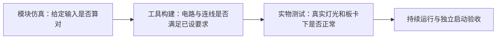

# 验证报告：做过哪些检查，还缺哪些证明

已有记录支持“设计完成了多轮模块测试和工具构建”，也有开发者上板观察。**当前还不能给出最终全功能、长时间稳定和脱离电脑启动均通过的结论。** 下面先按实际问题说明，再保留各阶段的原始数据。

## 先看结论

|关心的问题|现有结论|还缺什么|
|---|---|---|
|能否采集和显示摄像头画面？|有历史演示和后续上板反馈|把现场加载文件、功能组合和视频记录对应起来|
|四种显示效果和 A/B/C 是否有实现？|有源码、模块测试及阶段观察|当前候选逐项切换、复位和连续运行的完整板测|
|白平衡是否解决了偏色？|没有；C 与 A 接近，可能略好|偏色仍按已知问题保留|
|Logo 是否接入？|工具和像素叠加测试通过，后续已有上板成功反馈|透明区、各模式和长时间运行的逐项记录|
|原红框靠边扩大会不会出现？|原版本已由实际视频确认，属于失败项|修复版在同类场景下的实物对照|
|修复版现在是什么状态？|新检测测试和 14 组既有回归通过；2026-10-18 已记录开发者反馈 `stable` 上板|现场文件指纹、修复效果、真实照明与 20～30 分钟记录|
|画面为什么暗？|初始化表等与本地官方基线一致；实际原因未确定|当前分支、曝光请求、读回和固定条件对照，见[亮度核查](SC520CS_BRIGHTNESS_BASELINE_AUDIT.md)|
|能否断电后独立启动？|`not tested`，尚无通过记录|Flash 固化及脱离电脑的冷启动测试|

“上板”指加载到真实开发板观察过，不表示所有测试完成。原始记录中的 `not tested` 保留生成当时的含义；较新反馈按日期补充，不改写历史日志。

## 三类检查分别说明什么

每一步都提供不同证据，不能互相替代。例如模拟的红点能被过滤，只能证明这些测试输入符合设计预期；真实红色背景仍可能被当作目标。

## 怎样读时序数据

|候选|最差建立时间余量（setup WNS）|最差保持时间余量（hold WNS）|工具报告覆盖率|
|---|---:|---:|---:|
|AWB 阶段基线|+0.103 ns|+0.020 ns|98.75%|
|Logo 候选|+0.106 ns|+0.021 ns|98.88%|
|原红色候选|+0.008 ns|+0.020 ns|98.91%|
|稳定性修复候选|+0.100 ns|+0.020 ns|98.95%|

正数表示已建模检查还有时间余量；原红色版本仅 0.008 ns，即 8 皮秒，余量很小。覆盖率不是运行成功率。这些历史报告没有覆盖全部外部接口、专用高速电路和真实电气条件，也不能证明不会偶发故障。指标解释见[术语表](GLOSSARY.md)。

## 一直保留的限制

- 原偏色和室内偏暗尚未解决；阶段演示曾接受这些限制，亮度核查没有给出确定根因。
- 红色框选不识别物体类别，可能选中红色背景；移动目标的框可能滞后。
- 历史无间隙帧首下 FIFO 丢数据反例仍保留；异常帧不保证无损恢复。
- 部分仿真替代了厂商模块或注入了信号，不能写成完整加密 DDR、HDMI 底层硬件仿真。
- 工具告警和失败运行仍在原始记录中；“重新综合”不等于“零告警”。

## 详细记录怎么找

[Logo 报告](SC520CS_LOGO_OSD_REPORT.md)、[原检测报告](SC520CS_RED_TARGET_REPORT.md)和[修复报告](SC520CS_RED_STABILITY_REPORT.md)分别给出算法、测试和构建来源；[板测记录](BOARD_VALIDATION.md)用于登记真实结果。下面保留历史各阶段的检查数量、数值、SHA 和失败边界。本文此次可读性整理没有重新运行这些仿真或构建。

各阶段历史验证数据与来源（点击展开）

## 2026-10-17：独立红色区域检测候选

本轮以用户反馈上板成功的 Logo 候选为基线，另建 `qa/sc520cs_red_target_trial_20261017`。颜色区域统计、跨帧确认、HDMI 黄色框与 RED TARGET 已整合到同一个镜像；四模式、室内 AE、A/B/C、按键及原修复保留。详细设计、失败证据、资源和复现步骤见[检测功能报告](SC520CS_RED_TARGET_REPORT.md)。未修改 release/current.json。

|检查|状态|证据和边界|
|---|---|---|
|检测/计数/确认/消失/异常/复位/恢复/无间隙连续帧|pass（仿真）|两种几何各 39 帧、2909421 项、0 错误；默认最小 160 像素的前一值/等值/后一值及最大计数覆盖|
|HDMI 叠加、Logo/面板保护、四模式保留|pass（源码/仿真）|文字逐像素、自检及实际顶层四模式/全帧 Sobel 回归；非完整加密 PHY/DDR 仿真|
|既有回归和最终来源绑定|pass|14 组继承回归 + 最终源码 AE 三场景，79 项编译记录/7 个目录和全部 73 源记录 SHA 一致|
|clean 综合、布线、checked bitgen|pass（工具）|syn_4→run_route_3→run_route_4_postopt→final→run_bitgen_red_checked；所有实际退出 0|
|setup/hold 与覆盖|pass（建模范围）|+0.008/+0.020 ns，TNS=0，覆盖 98.91%；8 ps setup 裕量很小，不作为稳健签核|
|灰码/诊断/检测邮箱预算|pass|36 条灰码 7.2 ns 最小 +6.023 ns；新 51 位邮箱 12 ns 最小 +11.039 ns；原预算和下游检查保持|
|资源|pass（容量范围）|LUT6 17234、REG 17823、Slice 18922/21216（89.19%）、ERAM 42、DSP 17|
|原候选、project/vendor、成功 bit 与暂存区|pass（所查保护范围）|7113 个文件 SHA/大小一致，Git 暂存区一致，阶段基线 394 项检查/0 错误|
|检测候选实物/20 分钟/最终验收|not tested|由用户提供绑定候选 SHA 的观察；当前等待不计通过|
|下载/Flash/无 PC 冷启动|not tested|本轮未下载、未写 Flash|

bit：`qa/sc520cs_red_target_trial_20261017/run_bitgen_red_checked/sc520cs_red_target.bit`，1789539 字节，SHA256 `7EBEC0062FF9966BEE76C043D831031FC9B09AD24DB62E0C34F08D781E289FFE`。简单颜色区域检测不宣称物体类别；移动目标有帧滞后，未绑定 DDR 帧槽。原偏色和无间隙 SOF FIFO 丢字反例、外部 I/O/PLL/硬 PHY/加密 DDR、MTBF 的验证边界继续披露，不统计比赛通过条目数。

以下保留上轮及更早阶段的构建记录，当前检测候选以本节和功能报告为准。

## 2026-10-17：独立 Logo OSD 候选

本轮对象为 `qa/sc520cs_logo_osd_trial_20261017`，来源为冻结的完整帧 AWB 基线。详细证据与复现命令见 [Logo 报告](SC520CS_LOGO_OSD_REPORT.md)。原 `release/current.json` 及阶段演示基线保持不变。

|检查|状态|证据与范围|
|---|---|---|
|官方安路 Logo 与独立接入|pass|官方 lab_ex_3 的 160×160 位图，DDR 后像素域、右上 (1088,16)，避开左上面板；RGB/DE/HS/VS 新增 3 级|
|位置/边界/透明区/同步/切换/复位|pass|实际 Logo RTL：3795937 周期、0 错误；越界裁切和四种模式背景均覆盖；非实物结论|
|既有功能回归|pass|14 组候选新回归最终通过，含实际顶层 AE、A/B/C、19 帧 C-AWB、四模式全帧/Sobel、CDC/复位/FIFO/I²C；模型边界详见 Logo 报告|
|clean 综合、布线、bitgen|pass|TD 6.2.168116，syn_1→run_route_2_postopt→final→checked bitgen；首轮 13 条 DDR setup 违例保留，经 post-route 最小物理优化修复|
|36 条灰码预算与时序|pass|四组各 9 位、预算 7.2 ns 全保留，最小 +5.923 ns；setup/hold +0.106/+0.021 ns、TNS 0、覆盖率 98.88%；仅建模范围|
|资源|pass|LUT6 16715，REG 17434，Slice 18385/21216，ERAM 42，DSP 17，见最终 route.area|
|保护范围|pass|原候选及 project/vendor 10900 文件 SHA 与大小不变；暂存索引一致，原基线 394 项校验通过|
|Logo 实物/当前四模式/长稳/复位|not tested|用户现反馈 Logo 基线上板成功；加载 SHA 未独立绑定，20 分钟和逐项实物验收待用户提供|
|Flash、无 PC 冷启动|not tested|本轮未下载、未写 Flash|

候选 bit：`qa/sc520cs_logo_osd_trial_20261017/run_bitgen_logo_checked/sc520cs_logo_osd.bit`，1789539 字节，SHA256 `04DF31EBD4758E2076B895F29004A2E8B15CDDDA7885F37798408F05A3E0D23A`。人工 SRAM 步骤及回退基线见 [Logo 报告](SC520CS_LOGO_OSD_REPORT.md) 的“bit 与实物测试”和候选 `BOARD_TEST_GATE.md`。

已暂停 AE/AWB 调参。既有偏色、历史无间隙 SOF 丢字反例、异常帧恢复限制及外部 I/O/PLL/硬 PHY/加密 DDR 的验证边界继续保留；不据工具完成推定实物通过。该 Logo 构建轮未包含检测扩展；本轮检测候选见上节。

## 完整帧 AWB 阶段基线的既有记录

验证对象为 [current.json](../release/current.json) 指定的完整帧 AWB 集成候选。2026-10-16 的验证包括文件与源绑定检查、必要 RTL 回归及公开文件独立导出检查。TD 综合、实现与 bit 生成结果引用该候选既有记录。

本次仓库整理未改变 RTL、IP、ADC、SDC 或 TD 工程输入，也未进行下载器或 Flash 操作。

## 文件与功能检查

|项目|状态|结果|
|---|---|---|
|工程与依赖|pass|70 条工程记录含 6 条自动排除项；路径全部存在，394 项依赖哈希匹配|
|显式活动 Verilog 模块|pass|解析得到 56 个模块名，未发现重复定义；加密和生成 IP 以 TD 展开记录为准|
|历史回归的源绑定|pass|8 组回归、105 项编译源匹配；当前灰度源与 CSA 全 RGB 穷举证书一致|
|公开文件独立运行|pass|19 项公开源文件校验通过，6 组基础回归通过|
|完整本地依赖检查|pass|本地依赖及 bit 匹配；公开导出缺少的 375 项依赖按预期报告|

本次当前源回归共 7 组：

|测试|检查规模|结果|
|---|---|---|
|小帧 AWB|7,987 项检查|errors=0|
|1280 × 720 完整帧 AWB|19 帧，17,510,400 像素，8,755,237 项检查|errors=0|
|长短按键与 A/B/C 切换|18 项检查|errors=0|
|状态 CDC|206 项检查|errors=0|
|室内 AE 控制|418 项检查|errors=0|
|AE 统计|9 项检查|errors=0|
|四模式处理|1280 宽、6 行，19,201 个有效拍及 19,262 项标记检查|errors=0|

测试使用当前候选目录中的自研 RTL。源哈希和结果汇总见 [validation.json](../release/validation.json)。原始输出位于本地 `build/current_tests/20261016_233744/`；独立公开导出结果位于 `exports/public_current_20261016/build/current_tests/20261016_234152/`。

首次沙盒执行中编译器异常退出，退出码为 3221225477；失败日志已保留。改用本机执行后，上述 7 组测试全部通过。

## 构建、资源与时序

现有构建记录为 `syn_6 → run_route_11_gray_csa → final 查询 → checked bitgen`。工程输入与原生源清单一致，选定 bit 的来源、大小和 SHA 已复核。此次检查未重新构建。

`syn_6` 的 `gate.area` 综合估算如下：

|LUT|REG|SLICE|DRAM LUT|ERAM20K|DSP|
|---:|---:|---:|---:|---:|---:|
|18,946|17,569|15,365|296|42|16|

|时序 / CDC 项目|结果|
|---|---|
|Setup WNS / TNS|+0.103 ns / 0|
|Hold WNS / TNS|+0.020 ns / 0|
|时序覆盖率|98.75%|
|36 条 Gray 路径|7.2 ns 约束有效，最小裕量 +6.097 ns|
|AE 176 bit 数据包|8 ns 约束，最小裕量 +7.112 ns|
|面板 177 bit 数据包|12 ns 约束，最小裕量 +11.127 ns|

以上结果适用于工具已建模路径。时序检查仍列出 4 类 dummy、36 个未设输入 delay 的对象、64 个未设输出 delay 的对象及 1 个部分输入 delay 对象；PLL lock、硬 PHY、DDR、MTBF 和外部电气验证尚未完成。

现有告警包括 SYN-5013 × 789、SYN-5025 × 3、加密 MC 中的 HDL-5369 latch × 1、SYN-5065 × 1，以及 PHY 时钟局部布线与路由告警。自研模块名称过滤下未发现新增告警。完整工程告警仍按原记录保留，摘录见 [historical_audit_excerpt.txt](../release/historical_audit_excerpt.txt)。失败的 TimingHigh 运行及负时序试验日志保存在本地 QA。

## 仿真覆盖范围

[历史测试清单](../release/historical_test_summary.csv)包含 19 组测试及独立负例。原厂 divider 的真实门级测试覆盖短帧；720 行原 AWB 测试使用经过门级比对的非恒定算术模型，新完整帧 AWB 的除法使用实际 RTL。接线层测试对部分 AWB 和 PLL 信号进行了注入。

因此，这些结果不等同于整个加密 ISP 的完整门级 720 行验证。历史无间隙 SOF 下的 FIFO 反例，以及异常帧不保证无损恢复的限制仍然保留。

## 板级状态

|项目|状态|说明|
|---|---|---|
|C 方案实物观察|pass，限所述观察|与 A 接近，可能略好；加载 SHA 未独立核验|
|偏色修复|fail|偏色仍然存在|
|全部模式、OSD 与反复切换|not tested，完整验收待完成|尚缺逐项板级记录|
|长期稳定性|not tested|20～30 分钟测试待用户完成；尚缺持续运行及异常统计|
|Flash 无 PC 冷启动|not tested|尚未执行独立启动测试|
|最终板级验收|not tested|待上述项目完成后评定|

实物依据及后续测试方法见[板级测试记录](BOARD_VALIDATION.md)。目前不据此统计竞赛已通过条目数。后续若改变工程输入或重新实现，须重新建立测试与网表证据的对应关系。

2026-10-17 阶段冻结：用户接受当前室内亮度和轻微偏色，暂停 AE/AWB 画质优化；原“偏色修复 fail”保留为事实，不作为当前主线。演示选 C，A/B/C 均保留；本轮只读检查 394 项依赖及 bit SHA 全匹配，未重跑仿真或构建。见[阶段基线](STAGE_BASELINE.md)和[比赛完成表](CONTEST_CHECKLIST.md)。

## 2026-10-17 红色区域稳定性独立修复

原红色候选已由用户上板，提供视频显示贴边扩框；不是完整长稳通过。独立修复候选 `sc520cs_red_stability_trial_20261017` 仅替换检测模块，密块区域筛选及有界迟滞；14组既有回归、新检测/边界/迟滞与Logo/叠加自检、clean综合、当前布局布线及精确约束复核和checked bitgen通过。最终setup/hold为 +0.100/+0.020 ns，覆盖98.95%；未放宽原时钟或预算。新候选上板、20分钟实测、Flash和无PC冷启动仍not tested。本轮无下载/Flash，原候选与成功bit保留，详见[稳定性修复报告](SC520CS_RED_STABILITY_REPORT.md)。

|检查项|状态|证据/下一步|
|---|---|---|
|新候选源码、自检、14组回归及clean构建/约束/bitgen|pass，限建模与工具范围|见稳定性报告、源码/bit哈希及原始日志|
|原红色候选贴边包围框稳定性|fail|用户31.28秒视频及同输入原RTL负例复现全局联合框扩张|
|修复候选实物与20分钟稳定性|not tested|用户按新SHA手动测试并提供结果|
|Flash及无PC冷启动|not tested|本轮不下载、不写Flash，另轮安排|

