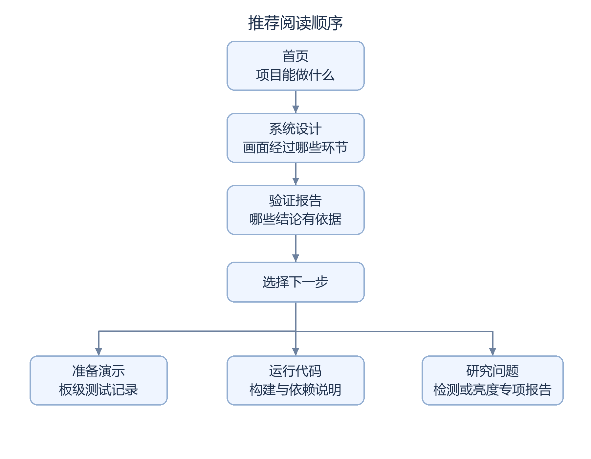

# 阅读指南

初次了解工程，从首页和系统设计开始；准备复现或验收时，再转到构建、依赖和板测文档。各专项报告保留自己的候选、日期和结果，阅读时先确认版本，避免把不同阶段的结论混在一起。

## 从概览到专项记录

流程图的可编辑源码

图形来源：[生成脚本](../scripts/render_doc_diagrams.py)中的 `reading_path` 定义；使用 Pillow 和固定中文字体生成。

1. 阅读[首页](../README.md)的功能、流程图和版本表，确认阶段基线与后续候选的关系。
2. 核对[系统设计](PROJECT_ANALYSIS.md)的模块分工，并按需核对展开的接口位宽与时钟数据。
3. 核对[验证报告](QA_REPORT.md)开头的结论，理解“仿真通过”与“实际运行可靠”各自需要什么证据。
4. 按复核目标查阅[板测记录](BOARD_VALIDATION.md)、[构建方法](CURRENT_BUILD.md)或[比赛完成表](CONTEST_CHECKLIST.md)。

缩写和指标定义见[术语表](GLOSSARY.md)。专项报告先交代问题与结果，再展开接口、寄存器、文件指纹和失败运行，便于按需查阅。

## 文档分工与版本范围

|报告|用途|适用范围|
|---|---|---|
|[阶段基线](STAGE_BASELINE.md)|AWB 阶段版本、文件与演示记录|固定记录 AWB 阶段，不随新候选自动更新|
|[Logo 报告](SC520CS_LOGO_OSD_REPORT.md)|官方 Logo 叠加设计与验证|构建时的“未上板”与后续反馈按日期分开|
|[原红色检测](SC520CS_RED_TARGET_REPORT.md)|原红色区域检测算法与失败案例|全帧颜色极值生成联合包围框，板级视频记录异常扩展|
|[稳定性修复](SC520CS_RED_STABILITY_REPORT.md)|相离红区联合包围框的稳定性修复|模块和工具检查通过，板级反馈与连续运行验收分别登记|
|[亮度核查](SC520CS_BRIGHTNESS_BASELINE_AUDIT.md)|稳定性候选与官方基线的亮度相关差异|已比较源码，实际传感器状态与偏暗原因仍待确认|
|[早期链路仿真](SC520CS_LINK_SIM_REPORT.md)|早期数据打包、帧首和复位缺陷|记录 2026-09-23 历史缺陷，不评价后续候选整体状态|

[暗红检测后继](SC520CS_DARK_RED_REPORT.md)记录 2026-10-19 降低最低 R 门槛的试验，包括对照方法、工具结果和板级待测项；该候选不替代 AWB 阶段基线。

## 验证状态与证据层级

报告中的 `pass` 表示通过，`fail` 表示失败或问题仍在，`not tested` 表示尚未测试或缺少足够记录。各状态须结合候选、日期和限定范围解释。

仿真通过表示给定激励下输出符合测试判据；工具构建通过需结合综合、布线、时序报告和文件生成分别判断。上板观察记录真实现象，最终验收还需绑定加载文件，并完成规定功能、连续运行和独立启动。

检测器自检无错误仅支持给定输入和模型下的结果，不证明实际照明下无误报，也不证明整板连续运行稳定。

## 公开资料与本地证据

普通文档链接指向公开说明或清单；标有“本地证据”的路径用于原工作机追溯。厂商 IP、完整候选、原始视频、bitstream 和大量工具日志未公开，相关原因及获取条件见[依赖说明](DEPENDENCIES.md)。`release/` 中的 JSON、CSV 和历史文本是机器清单或原始摘录，数值保持原样；结论与验证边界以对应报告为准。
