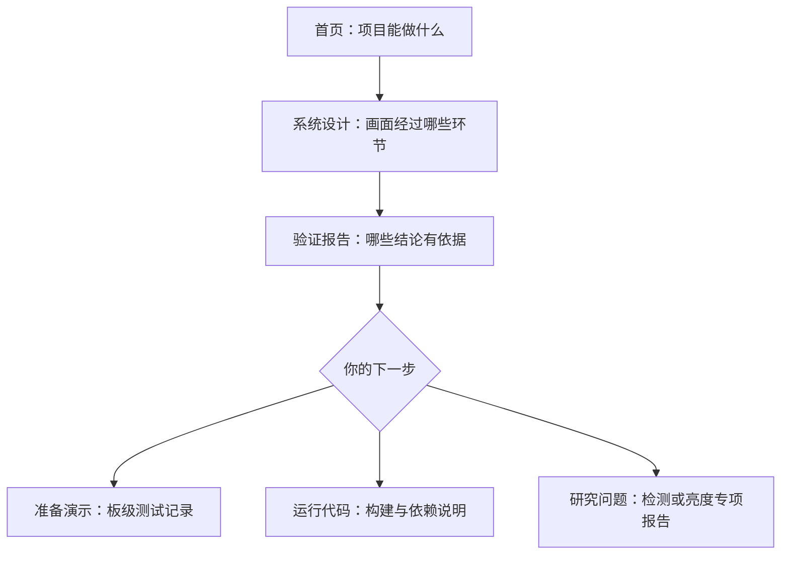

# 阅读指南

如果你只学过基础数字电路或单片机，先记住一条主线：摄像头不断产生像素，FPGA 一边接收一边处理，把画面暂存后送到显示器。工程的困难除了“怎样改颜色”，还有“怎样让每个像素在正确的时间到达正确的位置”。

## 推荐阅读顺序

1. 先读[首页](../README.md)的功能、流程图和版本表，分清阶段基线与后续候选。
2. 读[系统设计](PROJECT_ANALYSIS.md)的模块分工，先跳过展开的接口位宽和时钟数据。
3. 读[验证报告](QA_REPORT.md)开头的结论，理解“仿真通过”与“实际运行可靠”各自需要什么证据。
4. 根据目标选读[板测记录](BOARD_VALIDATION.md)、[构建方法](CURRENT_BUILD.md)或[比赛完成表](CONTEST_CHECKLIST.md)。

遇到缩写时查[术语表](GLOSSARY.md)。专项报告先说明问题和处理办法，再保留可展开的工程记录。只想了解结论时不必逐项读 SHA、寄存器地址或失败运行目录。

## 几份容易混淆的报告

|报告|回答的问题|阅读时要注意|
|---|---|---|
|[阶段基线](STAGE_BASELINE.md)|以前选定的演示版本是哪一个？|它是保留的 AWB 版本，不会随新候选自动改变|
|[Logo 报告](SC520CS_LOGO_OSD_REPORT.md)|怎样把官方图形放到视频右上角？|构建时的“未上板”与后续反馈按日期分开|
|[原红色检测](SC520CS_RED_TARGET_REPORT.md)|最初怎样找出红色区域？|全画面红点合成一个框，实际发现扩框问题|
|[稳定性修复](SC520CS_RED_STABILITY_REPORT.md)|怎样避免远处红点把框拉大？|工具测试通过；上板反馈不等于长稳验收|
|[亮度核查](SC520CS_BRIGHTNESS_BASELINE_AUDIT.md)|画面偏暗是否因为改低了官方参数？|已比较源码，实际传感器状态与偏暗原因仍待确认|
|[早期链路仿真](SC520CS_LINK_SIM_REPORT.md)|早期数据打包和帧首标记哪里有问题？|它是历史缺陷记录，不是当前全部功能的状态报告|

## 怎样判断一句“通过”有多大范围

报告中的 `pass` 表示通过，`fail` 表示失败或问题仍在，`not tested` 表示尚未测试或缺少足够记录。始终连同括号中的范围一起读。

“仿真通过”是测试程序输入的数据符合预期；“工具构建通过”是设计在当前约束下完成转换、布线和文件生成；“上板观察”是开发者确实看到某种现象；“最终验收”还需要确认使用的文件、功能组合、连续运行和独立启动。

一个简单例子：检测器的几百万项检查没有报错，能支持“这些测试中的检测结果正确”；它无法证明真实灯光下不会误检，也无法证明整块板能连续运行半小时。

## 哪些文件在 GitHub，哪些只在本地

普通文档链接指向公开说明或清单；标有“本地证据”的路径用于原工作机追溯。厂商 IP、完整候选、原始视频、bit 和大量工具日志未公开，相关原因及获取条件见[依赖说明](DEPENDENCIES.md)。`release/` 中的 JSON、CSV 和历史文本是机器清单或原始摘录，数值保持原样；阅读结论请从对应报告进入。
