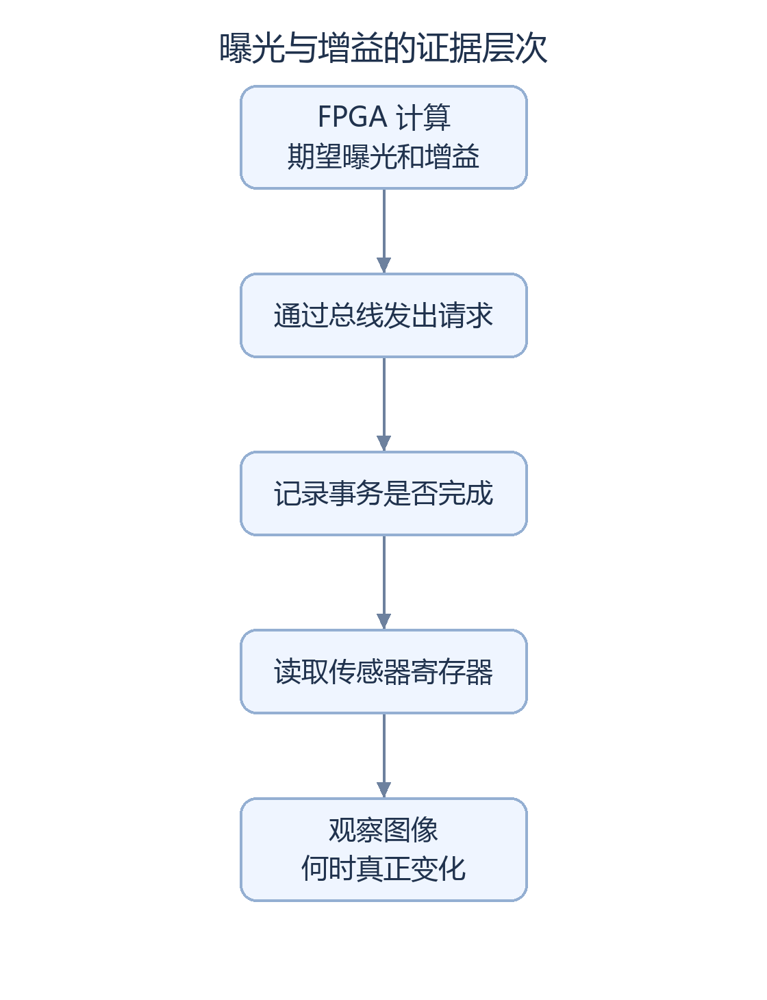

# SC520CS 亮度差异与官方基线核查报告（2026-10-18）

本报告核对稳定性修复候选与本地保存的官方 SC520CS Lab1 源码，检查曝光、增益、像素取值范围及有效图像链差异。

核查结论：相对于本地保存的官方 SC520CS Lab1 源码，没有发现降低初始化曝光、模拟增益或缩减原始像素取值范围的改动。主要运行差异在于自动曝光控制和可选白平衡分支。**仍无法确定偏暗的根因，也没有证明摄像头实际应用了请求的增益。**

## 源码差异核查结果

|核查内容|发现|实际含义|
|---|---|---|
|启动时写给摄像头的参数表|165 项地址、数据及顺序相同|没有证据说是初始化表被改暗|
|原始像素取值与颜色打包|关键文件及公式相同，彩色直通没有统一压暗系数|位宽重排不等于额外降低亮度|
|黑电平和亮度曲线模块|两份有效链路都没有接入相应 BLC、gamma 模块|不能仅因源码里有定义就说它正在处理图像|
|运行期自动曝光|当前版本按图像统计发请求，官方配套版本采用手动控制路径|要检查运行时发生了什么，不能只看初始化|
|A/B/C 白平衡|不同分支会影响通道比例与合成亮度|做对比时需先记录实际分支|
|官方对照 bitstream|发现历史文件，但没有确认来源、720p 模式和当前板卡匹配同时满足|不能仅凭文件名就当作可靠对照|

## 请求、事务完成与传感器读回

流程图的可编辑源码

图形来源：[生成脚本](../scripts/render_doc_diagrams.py)中的 `exposure_evidence` 定义；使用 Pillow 和固定中文字体生成。

面板 `REQ` 表示 FPGA 请求值，`DON` 表示事务完成目标，二者均不等同于传感器实时寄存器读回。现有快照未持续刷新完整状态，历史候选读值不适用于推定 `stable` 的实时状态。

## 待核实事项与对照条件

现场对照须记录文件、彩色模式和 A/B/C 分支，以及面板请求、完成、明暗统计和错误状态。只有在官方镜像来源与板卡匹配确认后，固定灯光、构图和显示器设置，才具备做官方与当前版本对照的条件。单次屏摄不足以判断问题来自传感器设置、颜色处理还是光照。

本报告已记录开发者反馈 `stable` 上板，但现场加载 SHA-256 未独立确认；这不等于完成连续运行稳定性或全功能验收。本次原核查只读取文件和已有产物，没有重新仿真、构建、下载或写 Flash。下方保留精确寄存器、来源哈希、板卡匹配障碍和未来对照条件。

2026-10-18 源码逐项对比与证据范围

2026-10-18 核查读取源码、清单和已有构建产物，形成报告及哈希记录；未修改 RTL、参数、IP、约束或 release/current.json，未执行构建、硬件下载或 Flash 写入。

结论：**相对于本地保存的官方 SC520CS Lab1 源码，本报告核查的 stable 没有降低初始化曝光、初始化模拟增益、VTS 或 RAW 截取位宽。BLC 和 gamma 均未接入两者的有效图像链。运行期最大的差别是自研闭环 AE，以及可选择的 B/C 白平衡。现有证据不足以把偏暗归因于官方基线，也不足以证明传感器实际达到请求的增益。没有找到同时满足原版来源、720p 摄像头模式绑定和当前板卡匹配三个条件的官方对照 bitstream。**

## 1. 核查对象与证据范围

2026-10-18 开发者反馈“stable已上板”，核查对象据此确定为 `qa/sc520cs_red_stability_trial_20261017`。`release/current.json` 对应 AWB 阶段基线，原 red_target 另有独立记录，均不作为本报告的被测候选。

- 2026-10-18 核查文件：sc520cs_red_stable.bit（本地证据：`qa/sc520cs_red_stability_trial_20261017/run_bitgen_red_checked/sc520cs_red_stable.bit`），1,789,539 字节，SHA-256 `BDD58CEB700E1A661CC3BF89BF0AF800395273C53285402B244520762E5ADFB5`。
- 工程：camera_to_dsi_display.al（本地证据：`qa/sc520cs_red_stability_trial_20261017/lab_ex1_mipi_hdmi/td_project/camera_to_dsi_display.al`），顶层 design_top_wrapper，PH1P35MDG324、Speed -3。
- 2026-10-18 核查重算 `red_source_manifest.json` 的 73 条工程记录，以及 `syn_1_input_hashes.json` 的 176 条输入记录，均匹配。bitstream 与既有 bitstream_manifest.json 匹配；没有重新综合或重新生成 bitstream。
- “stable已上板”为开发者实物反馈原文；现场实际选择文件的 SHA-256、当前彩色/处理模式及 AWB A/B/C 分支未独立确认。该次本地哈希核对不构成板内镜像识别。
- 保留 stable、red_target 和 frame_awb 成功文件；2026-10-18 核查实测 SHA-256 见 source_evidence.json（本地证据：`docs/brightness_audit_20261018/source_evidence.json`）。旧 manifest 的 `board: not tested` 是生成当时记录，2026-10-18 板级反馈不构成全功能或连续运行稳定性验收。

以下路径缩写用于表内定位：

|缩写|绝对根路径|
|---|---|
|H|`D:/FPGA/HX1P35A_Image/qa/sc520cs_red_stability_trial_20261017/lab_ex1_mipi_hdmi/user_source/hdl_source`|
|R|`D:/FPGA/HX1P35A_Image/qa/sc520cs_red_stability_trial_20261017/rtl/custom`|
|O|`D:/FPGA/HX1P35A_Image/vendor/official_sc520/SC520CS摄像头资料/lab_ex1_mipi_hdmi_SC520 (2)/lab_ex1_mipi_hdmi_SC520/lab_ex1_mipi_hdmi`|
|OH|`O/user_source/hdl_source`|

O 是本地保存的官方资料基线。2026-10-18 核对 2026-10-07 `copy_manifest.csv` 的 216 个来源文件全部匹配，没有发现相对该清单的漂移。该核对不能反向证明历史 bitstream 就由这些字节生成，也不能代替官方原始包或发布哈希。源码中的“验证”“关闭 Slave”等注释反映该配套版本的配置，**仅凭注释不能断言本地后来改过官方原件**。

## 2. 相同：初始化及共同图像链

|核查项|本报告核查的 stable 与本地官方 Lab1|源码位置|
|---|---|---|
|活动初始化表|165 项地址、数据及顺序全部相同；文件 SHA-256 也相同。活动选择是 uics520reg_720p60，不采用未启用的全尺寸表|H、OH `uics520_cfg/uics520reg_720p60.v:12–180`；`uicfgcs520.v` 的 u_init_regs；各自 .al|
|曝光初始化|3E00/01/02=`00/7C/70`，拼成曝光码 `0x07C7=1991`，单位半行|两份 `uics520reg_720p60.v:119–121`；AE 表 `uics520regAE.v:15–17`|
|模拟增益初始化|3E09=`00`，对应 1 倍模拟增益；不能表述为初始化已经是 16 倍|两份 `uics520reg_720p60.v:122`|
|数字增益初始化|165 项表内没有写 3E06/07。不能将后续 AE 请求的 `00/80` 倒填为初始化显式值；当前传感器复位值/读回另行区分|两份初始化表全文；后续写入见 `uics520regAE.v:19–20`|
|VTS|320E/F=`03/E8`，1000 行；当前 AE 不写 VTS|两份 `uics520reg_720p60.v:39–40`；完整八项 AE 表|
|模式及其他初始化|1280×720、3222=`00`，包括 3901/3905/391D/3926 等传感器设置也随整表相同。不能只比较曝光而忽略其他表项|两份 `uics520reg_720p60.v:35–47,114–118`；165 项比较记录|
|增益映射及八项更新表|SC520GainTbl 与 uics520regAE 两文件逐字节相同|H、OH `uics520_cfg/SC520GainTbl.v:17–42`、`uics520regAE.v:12–22`|
|RAW10 拆包及截取|先还原四个10位像素，再各取高8位 `[9:2]`、`[19:12]`、`[29:22]`、`[39:32]`。对应满量程1023→255，不是额外把8位RGB再除4；暗部低2位精度被两者共同舍弃|H、OH `isp/raw10_unpacket_2lane.v:88` 起；`isp/demosaic_4x_2_0/mipi_to_raw_converter.v:46–52`；两文件 SHA-256 相同|
|demosaic/像素压缩|demosaic、raw_matrix、bilinear_interpolation 和 data128_96 文件 SHA-256 相同；BGGR 配置一致。128→96 为取每个32位槽的24位RGB，不是缩小各颜色数值|H、OH `isp/isp_top.v` 的 u_demosaic；`isp/data128_96/data128_96.v:16`|
|FPGA 黑电平 BLC|BLC.v 默认四路偏移15，文件相同；但两份 .al 均未列入该文件，有效 demosaic 链 raw_matrix 直接接 mipi_to_raw_converter，没有实例化 BLC。因此不能将15说成已执行的黑电平扣除|H、OH `isp/BLC/BLC.v:11–15`；`isp/demosaic_4x_2_0/raw_matrix_3x3_buffer.v:135` 起；`isp_top.v` 与 .al|
|gamma|两份 isp_top.v 均附有 axis_gamma_rgb96/gamma07 模块定义，但顶层有效路径没有实例化它；函数存在不表示 gamma 已启用。没有发现 stable 相对该基线取消一段活动 gamma|OH `isp/isp_top.v:118` 起；H 同文件 `:219` 起；两个 isp_top 主模块连接|

曝光上限 `2×VTS−9=1991` 及模拟增益编码的依据是本地 SC520CS-03 数据手册 V1.6 PDF第20页；2026-10-18 核查主要结论来自相同表项与源码连接，未将标称60fps作为该次帧率测量结果。

## 3. 不同：初始化后的 AE、AWB 和 RGB 路径

|核查项|官方配套 Lab1|本报告核查的 stable|源码位置|
|---|---|---|---|
|曝光/增益控制|ae_set 提供手动调节；复位目标1991/144，输出先设1990/17，配置结束后触发一次1991/144请求。顶层 `{I_button,2'b11}` 将曝光减/加输入固定为未按，实际按钮接增益减/加。没有图像亮度闭环|custom_closed_loop_ae，首个合格 SOF 请求1991/144，之后按图像测光更新|OH `uiisp_beta/ae_set.v:73–121`、`design_top_wrapper.v:546–556`；H `design_top_wrapper.v:564–584`；R `custom_closed_loop_ae.v:1–12,65–76`|
|允许曝光|ae_set 中形式范围2..1991；按现有顶层接线曝光按钮未开放，默认1991|4..1991 半行；不延长 VTS|OH `ae_set.v:88–96`；R `custom_closed_loop_ae.v:7,30–58`，顶层没有覆盖参数|
|允许增益|控制码16..176，按键逐步调节，可经过数字细增益中间码|控制码16..176，当前从144以±32切换，可达16/48/80/112/144/176；对应模拟1/2/4/8/16/32倍。按当前控制算法这些档位数字码均为3E06/07=`00/80`，即数字1倍|两份 SC520GainTbl；R `custom_closed_loop_ae.v:41–47`。不能将“控制码176”说成176倍|
|测光与限幅|无测光自动更新|AWB前 RGB888；Y=(R+2G+B)/4，中央宽高中间各半区域权重4，其余权重1。目标112±12；通常按曝光约1/4步长调节；到曝光上限后可升一档模拟增益并减曝光，再继续调节；受饱和冲突、帧资格、更新间隔及总线错误限制|R `custom_ae_frame_stats.v:1–6,35–65`；`custom_closed_loop_ae.v:3–7,30–58,109–126`；H `isp/isp_top.v:122–127`|
|AWB A|原有 R/B 通道统计、divider与Q16乘法，G保持；R/B超过255饱和|保留该数学路径；新增旁路输出/诊断，但原有算法段不变|OH `awb.v:211–235,300–352`；H `awb.v:215–239,306–358`；2026-10-18 核查逐行差异检查|
|AWB B/C|无 B/C 选择|B单位增益，RGB保持；C完整帧样本筛选及平滑，R/B限0.5..2倍，G保持1倍。样本范围16..239、通道比≤4:1，至少全帧1/16样本，帧边界提交。因此不同分支会改变颜色与合成亮度，现场分支未确认|R `custom_frame_awb.v:4–10,24–41,52–53,85` 起；H `awb.v:388–416`、`isp/isp_top.v:50–63,169–186`|
|彩色RGB通路|AWB后直接96→128打包|AWB选择后进入四模式处理；彩色模式只寄存传递，不乘一个统一压暗系数。灰度/二值化/Sobel 边缘检测会改变亮度，应只用彩色模式比较|R `custom_processing_top.v:70–110`；H `isp/isp_top.v:169–206`|
|96→128|原版打包|增加复位、帧首等待；有效数据拼接公式保留，没有亮度缩放|H `isp/data96_128/data96_128.v:19–87` 与 OH 同文件差异|

**当前 AE 覆盖的传感器事务完整顺序**：

|顺序|地址|数据/作用|
|---|---|---|
|0|3812|00，group hold|
|1|3E00|`{4'h0, exposure[15:12]}`|
|2|3E01|`exposure[11:4]`|
|3|3E02|`{exposure[3:0],4'h0}`|
|4|3E09|增益表模拟粗增益码|
|5|3E06|增益表数字粗增益码|
|6|3E07|增益表数字细增益码|
|7|3812|30，group release|

来源 H `uics520_cfg/uics520regAE.v:12–22`；配置控制器在接受时锁存 active_ae/ag，防止同组混用请求，见 `uicfgcs520.v:264–271,377–388` 的状态机与实例。它不写320E/F，不改RAW位宽、BLC或gamma。

首组请求1991/144对应曝光 `00/7C/70`、模拟/数字 `0F/00/80`。AE允许最大曝光1991、最大模拟32倍、数字1倍；**允许范围和请求规则不代表现场已经到上限**。需要现场REQ/DON/Y/S/E及AWB行，才能判断是在限幅、未完成、故障停止还是正常目标带。即使达到上限仍暗，也只能说明该范围下仍不足，不能直接归因为官方初始化问题。

## 4. 仍未确认：请求、完成和实际读回

|证据层级|2026-10-18 核查已知|不能据此宣称|
|---|---|---|
|初始化值|表中明确写00/7C/70、模拟00、VTS03/E8；数字未显式写|该次现场传感器状态仍为这些值|
|运行时请求|首组1991/144，闭环可变；REQ显示的是S_ae/S_ag|请求已被传感器接受或应用|
|事务完成|DON是FPGA记录的完成目标；状态机有ACK/错误与停止机制|DON是传感器寄存器读回，或对应图像已生效|
|传感器读回|cfg具备首组后十项随机读，以及三个后续CSI SOF后的另一次读；地址包括3E00/01/02、3E09/06/07、320E/F、3221、3812|它们是持续随闭环刷新的当前状态；面板R0主要显示历史首次3E09，不是当前全部寄存器|
|2026-10-18 核查现场读回|未收到 stable 的新面板/总线读回值|把旧候选的00/7C/70、00/00/80直接套给stable|

源码：H `uics520_cfg/uicfgcs520.v:94–111,257–280,323–347` 的 snapshot_address、首读/延后读状态机；H `design_top_wrapper.v:966–975` 的状态打包；R `custom_ae_overlay.v:52–87` 的REQ、DON与R0显示。当前面板没有周期性随机读；延后十项内部保留也不是持续闭环读回。

历史资料中 `qa/sc520cs_i2c_protocol_timing_trial_20261012` 曾被开发者反馈首读 `00/7C/70、00/00/80、03/E8、00、00`，记录见归档 SC520CS_AE_GAIN_READBACK_AUDIT.md（本地证据：`qa/_local_archive/pre_cleanup_20261016/docs/SC520CS_AE_GAIN_READBACK_AUDIT.md:3`）。它属于不同候选和不同时间；特别是3E09读00与请求0F之间的区别，不能由本次核查的文件一致性或仿真发送成功消除该历史差异。

本地手册关于N+2帧图像生效、group释放的说明，也不足以完整定义3E09影子bank/读bank或3812命令寄存器读回含义。源码、ACK、随机读和图像响应须分别记录。本报告核查的 stable 的现场传感器实际增益与图像响应仍未确认。

## 5. 官方原版 bitstream 查找结果与 SRAM 对照条件

查找范围：本地 vendor/official_sc520 的Lab1/2/3、官方原件QA副本、仓库相关清单/归档，以及桌面安路资料中的镜像和压缩包；另只读检查桌面“安路技术文档.zip”目录，没有找到可补齐SC520 Lab1对应关系的条目。未联网下载。

**发现历史 SC520 Lab1 bit，但没有确认可作为当前板卡的官方原版720p对照。** 以下SHA-256均为2026-10-18 计算结果：

|发现文件（O下相对路径）|SHA-256|结论|
|---|---|---|
|td_project/camera_to_dsi_display_Runs/best_result/camera_to_dsi_display.bit，与phy_1同名文件相同|`2B90F6D85F2B319A9ED33C8839174A64F083FB6A7B4B087A2E8DDA139938D0EA`|有历史phy_1生成日志和PH1P35MDG324标识；没有源码输入哈希/板修订绑定，不能仅凭best_result名称认定匹配|
|td_project/camera_to_dsi_display_Runs/phy_1/camera_to_dsi_display_1280x720_60fps.bit|`7E1339F86C57BF62C04F5B503646CDAA26158F613FD2DBEAE50143D28AFFE96B`|文件名匹配目标分辨率；没有该命名文件与对应网表、相机表、引脚/DDR配置和板卡版本的专属发布清单。文件名不是构建绑定证明|
|同目录的1080p、1600×900、1792×1080、HDMI_COLORBAR、hdmi_core_tpg及cw/compiled等|详见source_evidence.json|其他模式/测试镜像，不作摄像头720p亮度基线|

Lab2边缘/Lab3叠加镜像也不代替Lab1；SC500CS镜像不代替SC520CS。10月7日官方原件副本只完成过综合，没有新bitstream，见 README（本地证据：`qa/sc520cs_official_board_baseline_20261007/README.md:3`）。

还有一项明确的板卡匹配障碍：O顶层 `design_top_wrapper.v:804` 将I_sys_clk接DDR，`ph1p35_ddr/ph1p35_324_ddr_wrapper.v:79–81`再接ref_clk/apb_pclk，而 `ddr2/ddr2.v:83–85`配置100MHz、DIV3/FBKDIV32；原引脚源是C4的50MHz。本报告核查的 stable 已改为独立S_100m_clk送DDR（H顶层:884–885），复位/模式键也采用C7/B9，原例程采用R10和其他输入。**器件相同不等于板卡接法和DDR参考相同。**2026-10-18 复核的是源码冲突，未测量板上时钟，未将源码差异推断为未绑定历史 bitstream 的实际行为。

因此目前缺少：官方原始发布包/发布者确认与SHA-256、指定720p摄像头bitstream的源码和构建绑定、当前HX1P35A板修订与DDR参考/复位/相机模组匹配说明。此前副本与官方来源的216项一致性，仅证明保存的输入一致，不能补齐历史bitstream链条。

现阶段不安排加载上述未知匹配镜像。待上述条件补齐后，SRAM对照记录应按以下顺序进行；以下为后续验证计划，2026-10-18 核查未执行这些操作：

1. 保留当前成功stable原文件与SHA-256，现场对照须记录文件/分支。固定相机、灯光、构图、镜头和显示器输入/画面设置，采用同一静态场景，避免把OSD区域计入亮度比较。
2. 本报告核查的 stable选彩色，记录实际A/B/C、REQ、DON、Y、SAT、状态和故障；固定观察时长，拍下未自动调曝光/白平衡的同一屏摄条件。不要把REQ或DON叫作传感器读值。
3. 仅在官方镜像来源与板卡匹配确认后，按已有BitWriter流程选择JTAG/SRAM易失配置，核对文件SHA-256及目标器件；不选Flash擦除、编程、固化。官方与stable分别重新完成相机初始化，避免上一组相机参数残留；若现有流程不能确保重置初始化，先标为不具备可比条件。
4. 同灯光、构图和显示器下拍摄官方图像，记录曝光/增益可获得的证据及等待时长。官方无相应读回能力时明确填未知，不用默认请求填读回栏。
5. 恢复同一成功stable文件至SRAM，重做初始化并选回相同分支，再拍一次，形成stable→官方→stable对照；观察灯光漂移及显示器自动亮度是否影响结论。

若官方同样偏暗，仅支持共同初始化/共同无gamma链路或相机光学/光照因素的可能性；若只有stable偏暗，应优先结合分支和AE实际请求/读回定位。单次屏摄不足以在这些原因之间定责。

## 6. 证据索引与限制

新增本报告与 `docs/brightness_audit_20261018/source_evidence.json`。后者保留候选/官方基线逐文件SHA-256、165项表比较、73+176项绑定校验及历史bitstream清单。未运行RTL仿真或TD流程；2026-10-18 的工作范围为静态来源与差异核查，不重复计入既有测试结果。成功 bitstream 保留；该次未测量现场亮度、传感器实时读回或官方镜像对照效果。

