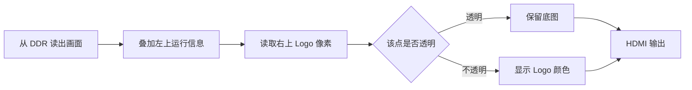

# Logo 叠加：怎样把安路标志放到画面上

这个候选在原摄像头画面的右上角加入官方“安路”图形，同时保留左上角的运行信息。它沿用 AWB 阶段的四模式、自动曝光和 A/B/C 控制。

## 做法与可见效果



Logo 使用官方 160×160 位图，放在 1280×720 画面的右上 `(1088,16)` 位置。它在四模式处理之后叠加，所以背景切成灰度或黑白时，Logo 仍可保留自己的颜色。像素与行、帧标记一起延迟，避免图案与画面错位。

## 验证结果与后续反馈

|检查|结果|范围|
|---|---|---|
|位置、透明区、边界、切换和复位仿真|3,795,937 项比较，0 错误|验证叠加电路，不是完整硬件实测|
|继承功能测试|14 组最终通过|失败的测试配套问题与重跑过程仍保留|
|最终工具时序|setup/hold 余量 +0.106/+0.021 ns|只适用于已建模检查，覆盖率 98.88%|
|实物观察|后续原检测报告已记录开发者反馈 Logo 基线上板成功|现场加载 SHA 未独立确认，完整模式和长稳验收待补|

下面正文是 2026-10-17 构建阶段的原始记录，其中“尚未上板”是当时状态。后续反馈见[原检测报告](SC520CS_RED_TARGET_REPORT.md)，最新总体状态见[验证报告](QA_REPORT.md)。这份 Logo 候选本身不包含后来新增的红色检测。

首轮工具运行虽然结束正常，细查仍有 DDR 时序违例；后续物理优化才使已建模检查通过。这也说明“程序正常退出”不能直接写成“时序和板测都通过”。更多指标见[术语表](GLOSSARY.md)。


<details>
<summary>Logo 接口、历史测试、失败轮次与构建数据（点击展开）</summary>

本轮从阶段演示基线 `qa/sc520cs_frame_awb_trial_20261016` 建立独立候选 `qa/sc520cs_logo_osd_trial_20261017`，接入官方安路图形 Logo。室内 AE、A/B/C 白平衡、短按/长按及既有修复保留，暂停画质调参。未下载、未写 Flash，实物验收继续为 **not tested**。`release/current.json` 仍指向原阶段演示基线。

## 实现与接口

工程入口：候选内 `lab_ex1_mipi_hdmi/td_project/camera_to_dsi_display.al`；顶层 `design_top_wrapper`；PH1P35MDG324、Speed -3。71 条工程源记录及 SHA 见候选 `logo_source_manifest.csv`。

官方资源为 `vendor/lab_ex3_osd_SC500_720P/lab_ex3_osd/user_source/hdl_source/anlogic_logo_rom.v` 中的 160×160 图形商标，素材原文件保留。候选 `rtl/custom/custom_logo_overlay.v` 内含时钟读取的原像素表，6387 条 alpha/RGB 常量和透明默认值逐条一致，证明见 `logo_splice_proof.json`；透明像素共 19213 个。未替换为文字或自行重画商标。

|路径|信号与域|延迟/行为|
|---|---|---|
|DDR → hdmi_mixer|RGB888 / S_hdmi_pixel_clk|原读使能、窗口、视频时序保留|
|mixer → AE 诊断面板|S_hdmi_out_* → S_diag_*|原 3 个像素寄存级，左上 160×208|
|诊断面板 → Logo|S_diag_rgb/de/hs/vs → S_logo_rgb/de/hs/vs|新增 3 级：地址寄存、ROM 读取、alpha 混合|
|Logo → hdmi_tx|S_logo_rgb/de/vs|HS 同步寄存并被自检；原 TX RGB 接口不使用外部 HS|

有效画面 1280×720，总时序 1650×750。沿用 PLL 推导的 HDMI_PIXEL_CLK（时序报告约 75.002 MHz、周期 13.333 ns）；无新 CDC、无背压。四种处理模式均在 DDR 之前，Logo 在最终像素域，所以同一镜像中均可显示彩色 Logo。

画布左上 `(1088,16)`，范围 x=1088..1247、y=16..175，右侧留 32 像素，不与 x<160/y<208 的诊断面板相交。alpha=1 用素材 RGB，alpha=0 透传输入；消隐 RGB 输出黑。RGB/DE/HS/VS 同延迟；低有效复位清输出和坐标，下一个 VS 重建帧原点。参数位置超出画面右/下边界时自然裁切，避免地址回卷。

继承源码比较仅有顶层连接和 .al 清单两项变化，另新增 OSD 源文件；`source_delta.json`、`logo_source_manifest.csv` 和 `LOGO_CONTRACT.md` 记录边界。引脚、PLL、DDR/MIPI/HDMI IP、基线约束字节不变；不改默认 RGB/A。

## 仿真与回归

Logo 独立自检使用 ModelSim 2020.3 Intel FPGA Starter Edition（版本见候选 `tmp_logo_modelsim/version.txt`），实际编译 `tb_logo_overlay.v` 和新增 RTL。参考数据 `logo_golden.mem` 独立从官方原素材提取，期望坐标由测试刺激给出，并逐周期比较实际输出。

`tmp_logo_modelsim/stdout.txt`：**checks=3795937、opaque=27482、transparent=85158、errors=0**，编译 Errors=0/Warnings=0，运行正常 $finish。覆盖四幅 1280×720 模式背景、逐像素 RGB 与 DE/HS/VS 延迟、Logo 内外/四边/透明区、右下角越界位置裁切、连续帧、帧中背景切换、启动和帧中复位、下一 VS 恢复。此处验证像素级叠加，不代表已仿真完整加密 DDR/HDMI PHY，也不代表板上显示通过。

受限环境 Icarus 编译以 0xC0000005 异常退出；普通宿主编译成功。耗时 Icarus Logo 运行在完成前停止，见 `logo_host_incomplete.txt`，不记为通过。最终采用上述 ModelSim 自检；重跑命令为 `powershell -NoProfile -ExecutionPolicy Bypass -File qa/sc520cs_logo_osd_trial_20261017/run_logo_modelsim.ps1`。

旧回归首次有两处测试配套问题：缺少 `before/uii2c.v` 历史对照，及旧按键测试假设按下即发短按事件。已在候选内补齐原对照并将旧测试改为短按释放后检查，保留失败证据；未修改功能 RTL。A/B/C 手势专项和修正后的按键集成均通过。14 组当前回归最终通过，原始两项 harness 失败仍保留在 logo_regression_status.txt，并由 functional_suite_status.txt、key_final_status.txt 的重跑结果解决。

本轮关键既有回归（全部为新候选实际执行）：

|检查|结果与证据（候选目录内）|
|---|---|
|NACK/I²C/等价/共享复位/真实FIFO/视频/ISP链路及旧缺陷负例|pass；functional_suite_status.txt：7 个脚本退出 0，负例 wrapper=0，OVERALL PASS|
|A/B/C 按键与处理模式集成|pass；awb_key_evidence.txt：18 项/0 错误；key_mode_evidence.txt：118 beats、7 帧/0 错误|
|室内 AE 与实际顶层串行闭环|pass；closed_ae_evidence.txt、closed_ae_actual_top_evidence.txt；normal/nack/update_nack 均退出 0；保留强制 PLL/ISP tap 的模型边界|
|完整帧 C-AWB（小图与全分辨率）|pass；frame_awb_full_evidence.txt：19 帧、17510400 像素、8755237 项检查、0 错误；小图另含稳态/边界/停钟/复位|
|实际 RAM、状态 CDC、诊断叠加|pass；awb_real_ram_evidence.txt、awb_status_evidence.txt（206 项）、diag_cdc_overlay_evidence.txt（286805 项），均 0 错误；ae_overlay_evidence.txt 通过|
|实际顶层四模式/A/B/C 链路|pass；link_iverilog_evidence.txt：small/full/sobel_full 均通过；厂商 IP 边界沿用原测试的 -i 与 force，不能据此声称完整 DDR 仿真|
|原 AWB 数值/门级短帧回归|pass；awb_arithmetic_full_pure_evidence.txt、awb_gate_short_evidence.txt；前者仅替换已验证的 divider 数值模型，后者为实际门级 divider/TD RAM 边界；后者保留 425 条既有 IP 端口/容量等仿真告警，未记为告警清零|
|编译源与综合输入绑定|pass；logo_test_binding_result.txt、logo_fresh_test_bindings.json，61 项编译记录（5 个测试目录）及全部综合输入 SHA 一致；Logo 自检绑定见 logo_modelsim_evidence_binding.json|

## 构建、时序与灰码预算

工具 TD 6.2.168116。全新 `syn_1` 从实际 71 条清单执行 read_design→opt_rtl→opt_gate，退出 0 并存在完成标记；输入 SHA 为 `syn_1_input_hashes.json`，完整日志 `syn_runner.txt`。首轮资源 LUT6=16715、REG=17434、Slice=18385 (86.66%)、ERAM=42、DSP=17；这是 route.area 的最终物理统计，不能与综合阶段不同口径的 LUT 计数混用。

|运行|实际结果|处理|
|---|---|---|
|syn_1 → run_route_1|clean 综合和布线完成；原始 SWNS/HWNS=-2.561/-2.523 ns，含未精确限定的异步入口|保留原始报告；不据此生成 bit|
|run_route_1 → first 当前网表审查|精确复位/CDC 约束后 SWNS=-0.316 ns、STNS=-2.288 ns；hold WNS=+0.021 ns；13 条真实 DDR 内部 setup 违例|fail，保留 `run_query_first_diag` 和 `first_diag_remaining_violations.tsv`|
|首轮灰码审查|36/36 条 7.2 ns 预算，四组各 9 位，最小 slack=+5.923 ns|pass（首轮网表）；优化后必须重查|
|首轮精确入口审查|保留 170 组下游检查；177 个诊断 bundle 位、12 ns 预算最小 +11.166 ns|pass（首轮网表），无下游 blanket cut|
|run_route_2_postopt → final|SWNS=+0.106 ns、STNS=0，HWNS=+0.021 ns、HTNS=0；当前网表审查退出 0|pass（建模范围）；36/36 灰码路径预算 7.2 ns，最小 +5.923 ns，未放宽约束|

首轮最差路径来自 DDR 控制器 `page_ctrl[2]` 事务 FIFO 输出寄存器，非 Logo 像素域。采用候选内 `phys_opt -post_route -effort high` 做最小物理修复，不修改 IP，不放宽约束。每次物理运行都重新从当前 `cfg_implement.v` 解析实际端点，旧 packed pin 不直接沿用。

继承的 HDL-5369、未连接/未驱动、RAM_STYLE 等工具告警继续披露，完整分类见 `logo_synthesis_warnings.txt`。122 条综合告警中未出现 Logo 模块引用；不把工具退出 0 描述为告警已消除。PLL/硬 PHY/加密 DDR、外部 I/O 延迟与板级验证覆盖不足仍是边界。

## bit 与实物测试

已完成 checked bitgen，退出 0。仅作为尚未上板的 SRAM 候选：

- bit：`qa/sc520cs_logo_osd_trial_20261017/run_bitgen_logo_checked/sc520cs_logo_osd.bit`（1789539 字节）。
- SHA256：`04DF31EBD4758E2076B895F29004A2E8B15CDDDA7885F37798408F05A3E0D23A`。
- 构建链：`syn_1 → run_route_1 → run_route_2_postopt → final → run_bitgen_logo_checked`。
- bitgen 当场重载精确约束并重算时序：setup/hold WNS **+0.106/+0.021 ns**，TNS=0；建模覆盖率 **98.88%**。详细见 `run_bitgen_logo_checked/bitgen_sta_status.txt`、`bitgen_sta_all.timing`、`bitgen_check_timing.txt`。
- 资源：LUT6 16715、REG 17434、Slice 18385/21216（86.66%）、ERAM 42、DSP 17。原阶段基线物理报告为 LUT6 14297、REG 17254、Slice 16703、ERAM 42、DSP 16；本轮增加 2418 LUT6、180 REG、1682 Slice、1 DSP。统计来自同一工具的 route.area。

裕量较小，且覆盖率不足 100%，只记为建模检查通过，不作为板级或外部 I/O/PLL/PHY/DDR 全覆盖签核。

上板步骤见候选 `BOARD_TEST_GATE.md`：先核对候选 SHA，再由用户按现有流程加载 SRAM；复位 RGB/A，核对右上 Logo、透明区和左上面板；短按循环四模式，长按 A→B→C→A（每档至少 20 帧，建议 3 秒），验证长按释放无额外短按；各模式复位并完成 20～30 分钟长稳，保存绑定 SHA 的完整画面视频。Logo、四模式本候选实拍、长稳、Flash/无 PC 冷启动均为 **not tested**。

阶段基线与成功 bit 保留，回退 SHA `794946D5664CA984C8033C62786BD026BE0DF223317D808743B6A2D367E83371`。历史无间隙 SOF FIFO 丢字反例和异常帧恢复限制继续保留；本轮不扩大这部分验证结论。简单目标检测扩展项仍未实现，不统计竞赛通过条目数。

## 保护与复现

候选 `protected_before.json` 对原候选及 project/vendor 全部文件建立了大小与 SHA 快照；暂存索引见 `staged_before.txt`。末次复核 `protection_after.json`：10900 个文件大小与 SHA 全一致，Git 暂存索引完全一致；`baseline_verify_current.txt`：394 项、0 错误。未覆盖成功 bit，未修改 project/vendor，未改 release/current.json，未提交或混入四项历史暂存成果。

构建命令在仓库根执行：

```powershell
powershell -NoProfile -ExecutionPolicy Bypass -File qa/sc520cs_logo_osd_trial_20261017/run_opt_gate.ps1 -RunName syn_1
powershell -NoProfile -ExecutionPolicy Bypass -File qa/sc520cs_logo_osd_trial_20261017/run_implement.ps1 -RunName run_route_1 -SynRun syn_1
powershell -NoProfile -ExecutionPolicy Bypass -File qa/sc520cs_logo_osd_trial_20261017/run_current_audit.ps1 -Route run_route_1 -Prefix first
powershell -NoProfile -ExecutionPolicy Bypass -File qa/sc520cs_logo_osd_trial_20261017/run_physical_diag_trial.ps1 -InputRoute run_route_1 -RunName run_route_2_postopt -Operation post_opt
powershell -NoProfile -ExecutionPolicy Bypass -File qa/sc520cs_logo_osd_trial_20261017/run_current_audit.ps1 -Route run_route_2_postopt -Prefix final
powershell -NoProfile -ExecutionPolicy Bypass -File qa/sc520cs_logo_osd_trial_20261017/run_logo_bitgen.ps1
```

运行脚本拒绝覆盖已有构建目录；复现时使用新的独立候选/运行名。首轮审查的非零退出是已记录的真实时序失败。

</details>
