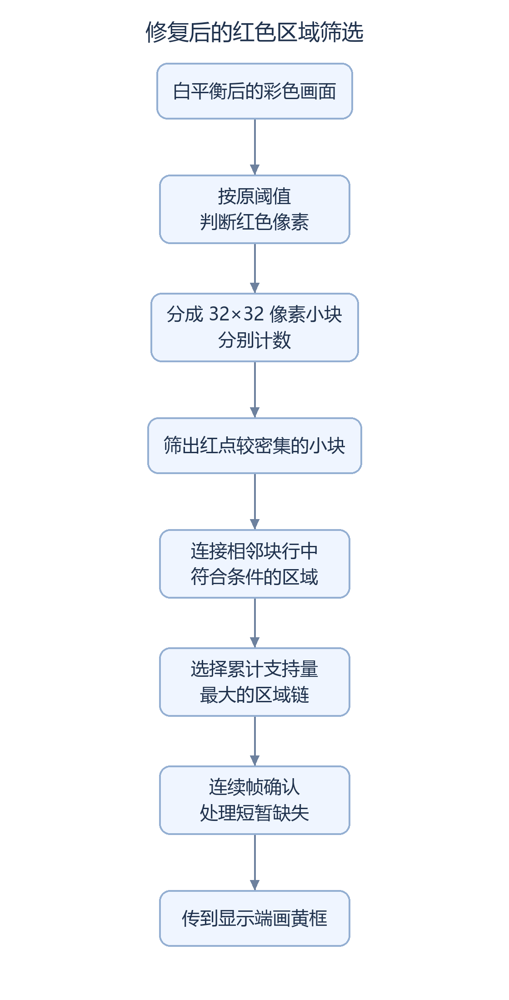

# 红框稳定性修复：减少远处红点把框拉大的情况

原算法把全画面红点合成一个框，实际视频发现靠边时框突然变大。本次修复改为优先选择较集中、彼此相邻的红色区域，减少远处零散红点的影响。

## 修复后的处理顺序



<details>
<summary>流程图的可编辑源码</summary>

图形由[生成脚本](../scripts/render_doc_diagrams.py)中的 `red_stability` 定义绘制，中文字体在生成图片时固定，显示时不再重新测量文字宽度。修改步骤或文字后，可用 Pillow 重新生成。

</details>

可以把它理解为：先找“红色比较集中在哪里”，再给选中的区域画框。小块计数会封顶，因此这里比较的是算法定义的支持量，不是精确数出哪个物体的红色像素最多。它也不是能完整区分所有分叉区域的连通域算法。

## 屏幕上的表现与取舍

|规则|可见影响|
|---|---|
|连续 3 个合格完整帧才确认|刚出现的目标需要短暂等待，减少偶发红点触发|
|已有目标时采用较低密度门槛|颜色轻微波动时，框较不容易反复出现和消失|
|最多保留 1 个缺失帧；第 2 个缺失帧撤销|短暂漏检可保留旧框；真实消失到显示清除仍有统计和传递延迟|
|按 32 像素块边界给框|框可能比实际红区宽一些，单边最多有 31 像素取整余量|
|只选一条区域链|多个红区可能改选；细小、稀疏或分叉区域可能漏掉|
|按颜色选择|大块红色背景仍可能成为目标，不能识别物体类别|

故障、异常帧、复位或失流会绕过短暂保留规则撤销结果。坐标在显示帧开始时成组更新，但尚未绑定 DDR 中的具体画面帧，运动时可能有延迟。

## 证据与当前状态

新检测器在小图、1280×720、贴边、颜色门槛、短暂缺失和异常恢复等测试中没有报错；14 组既有回归最终通过。最终已建模时序为 setup/hold **+0.100/+0.020 ns**，覆盖率 **98.95%**。详细数量与失败轮次见下方记录。

2026-10-17 构建时尚未上板；2026-10-18 的[亮度核查](SC520CS_BRIGHTNESS_BASELINE_AUDIT.md)补充了开发者“stable 已上板”的反馈。**现场加载 SHA、扩框改善程度、真实照明适应性和 20～30 分钟稳定性仍需记录。** 原正文中的未上板描述保留为历史时点，不当作最新状态。Flash 和脱离电脑的断电启动仍未测试。

本地文件为 `qa/sc520cs_red_stability_trial_20261017/run_bitgen_red_checked/sc520cs_red_stable.bit`，1,789,539 字节。SHA256：

```text
BDD58CEB700E1A661CC3BF89BF0AF800395273C53285402B244520762E5ADFB5
```

该指纹用于核对本地文件，不是对板内镜像的自动识别。阶段基线、原候选和成功文件均保留，`release/current.json` 没有切换到本候选。


<details>
<summary>稳定性算法参数、全部测试与约束审查记录（点击展开）</summary>

已从用户报告上板成功的红色检测候选建立独立 `qa/sc520cs_red_stability_trial_20261017`。修复候选完成自检、相关回归、clean 综合、布局布线、当前网表约束复核及 checked bitgen；本轮未下载、未写 Flash，修复后实物效果和20分钟结果仍为 not tested。

## 基线及视频证据

原候选 `qa/sc520cs_red_target_trial_20261017` 的成功 bit 为 `run_bitgen_red_checked/sc520cs_red_target.bit`，SHA256 `7EBEC0062FF9966BEE76C043D831031FC9B09AD24DB62E0C34F08D781E289FFE`。本轮重新核对该 SHA，并保留原候选、Logo 成功 bit 和阶段 release/current.json。用户反馈中央可框住、移到边缘突然扩框；视频本身不能独立绑定现场加载 SHA，也不是20分钟验收。

视频 `e57ed4ee190f92d9275986b4fcebca4c.mp4`，907帧、1280×720、约29fps、31.276秒，SHA256 `2E7CD8F6220BC1C0CC1EB78557DF2A05CC45B680AEBADD54D0D4458B81437AD7`。26–30秒右侧目标部分出画，左侧暖色小块同时在场，黄色框跨越背景。采样及原路径见候选 `video_evidence/video.json`、`contact.png`；屏摄颜色与叠影不能等同于检测输入RGB或CDC撕裂。

|核查项|结果|
|---|---|
|全画面红像素直接取极值|确认存在。原算法只用全帧160像素门槛，任何远处命中均可拉大框。相同输入的实际原RTL负例12号把框扩成 (0,0)..(1279,704)，修复后为 (1216,288)..(1279,415)。|
|清零、首末像素、边界及异常帧|未发现另一项导致本次现象的计数错误；完整帧、同拍/独立EOL、无间隙帧、四角、部分出画、短/长行、重复SOF、fault、停流和复位恢复已自检。新双银行异常时清空，最后块行裁到719。|
|CDC相干与显示帧首更新|保留持有数据/req/ack邮箱及HDMI VS原子锁存；异步包一致性和叠加回归通过，按本次实际网表重新证明入口、复位链和12ns数据预算。|
|AE/AWB背景入阈值|可能改变颜色命中，视频不足以量化；不把它判为已排除。保持AE/AWB及相机配置，增加颜色边界和密度迟滞测试，真实照明效果待测。|

完整分析见本地候选 `DIAGNOSIS.md`。这是颜色区域筛选，不是物体类别识别。

## 最小修复与接口

73条 `.al` 源记录全部解析至独立候选；相对成功红色候选仅 `rtl/custom/custom_red_detector.v` 不同，见 `red_source_manifest.json`、`source_delta.json`。输入仍为四模式选择前、A/B/C白平衡选择后的彩色RGB888四像素/拍；视频数据链无新增延迟。四模式、室内AE、A/B/C、按键、Logo、诊断面板、引脚及已有时钟/复位/FIFO修复保持。

颜色阈值保持 R≥144、R−G≥48、R−B≥48。新增32×32块密度，计数到64饱和，双银行2×40×7位，与下一条带并行扫描。每个块行保留支持量最大的连续密块横段，同分取左；相邻块行横段重叠或对角相邻才接成链；最终取累计支持量最大链，同分取先扫描者。相离红区不直接取全局联合框。它不是完整连通域标记；分叉、细小、稀疏区域可能被切分或漏检，红色同类大背景仍可能被选中。

进入密块门槛64、已有目标时48；候选支持量为合格块计数到64饱和后的保守下界，至少160，连续3个完整帧进入。每个合格帧直接采用当前区域坐标，不做坐标平滑；最多保留1个缺失帧的旧框，第2个缺失帧撤销。异常、fault、复位、失流绕过迟滞立即撤销。框按32像素块边界取整并裁至1279/719，最多31像素余量。构建参数范围和边界条件见 `RED_STABILITY_CONTRACT.md`。

完整帧最后EOL之后44个CSI周期内发布57位packet，原握手邮箱跨到HDMI；VS上升沿锁存正结果和全部坐标。无效packet即时撤销；四个显示VS无新seq也清除。没有把元数据绑定DDR帧槽，仍存在后续显示帧延迟。HDMI mixer后保持一拍RGB/DE/HS/VS同延迟，2像素黄框与RED TARGET避开左上160×208面板及右上Logo保护区；原面板和Logo优先级不变。

## 实测仿真与回归

|项目|实际结果|
|---|---|
|新检测器小图256×160|29主测试帧，206658项检查，0错误|
|新检测器1280×720|29主测试帧，4615435项检查，0错误；另含fault/短行/停流/复位恢复刺激|
|密度与迟滞|18帧，26项检查，0错误；63/64进入、47/48退出、准确3帧进入/2帧退出|
|真实分辨率边界|11帧，9项检查，0错误；四角、四边和仅剩16像素入画|
|行内停顿/分析中断|11帧，16项检查，0错误；帧末扫描中fault/复位撤销未发布结果|
|合成曝光/增益颜色矢量|20帧，29项检查，0错误；亮度下降/恢复、R-G/R-B相差1、高亮白背景及孤立红点；不等同真实光照测试|
|首末有效拍临界计数|6帧，9项检查，0错误；每块恰64红像素，漏首/末拍即不足支持量，同拍/独立EOL|
|旧检测器及未改OSD/CDC/模式回归|小图/完整尺寸各39帧、2909421项检查、0错误；明确属于原算法负例和叠加基线，不冒充新区域规则测试|
|安路Logo|3795937项检查，0错误|
|继承回归|14组实际子进程退出0，见 logo_regression_status.txt、red_regression_final.json|
|源码/夹具绑定|综合输入、73条源记录、实际编译清单和运行前复制的测试夹具一致，见 red_test_binding_result.txt、final_unit_binding.json|

独立离线参考先计算块密度与区域链，再与RTL逐帧比较；负例同时驱动原RTL与修复RTL。涵盖静止、移动、贴边、部分出画、消失、零散红点、小红块、多块取舍、曝光/颜色阈值变化和复位。既有回归保留I2C/NACK、AE实际顶层正常/NACK/更新NACK、四模式、A/B/C手势、AWB完整帧及真实RAM、厂商divider短帧、诊断CDC/OSD、复位、FIFO及视频链路。其force、数值模型和加密IP边界按原报告解释；无间隙SOF/FIFO历史负例继续披露，不因新检测器无间隙通过而宣布修复。

## Clean构建、时序与约束

工程入口 `lab_ex1_mipi_hdmi/td_project/camera_to_dsi_display.al`，design_top_wrapper，PH1P35MDG324、Speed -3、TD 6.2.168116。实际链：`syn_1 → run_route_1 → final 当前网表复核 → run_bitgen_red_checked`。所有失败试验目录保留；当前源与综合及测试绑定。

|项目|结果|
|---|---|
|Setup WNS / TNS|+0.100 ns / 0.000 ns|
|Hold WNS / TNS|+0.020 ns / 0.000 ns|
|STA覆盖率|98.95%|
|Gray约束|36/36条，仍7.2 ns，最小裕量 +6.011 ns|
|红色邮箱|35个实际存活寄存位，仍12 ns，最小裕量 +11.221 ns；逻辑packet仍57位；35位存储/预算覆盖和22位无物理负载清单见red_optimized_storage_proof.json|
|时钟与其他预算|CSI 9.660 ns、HDMI 13.333 ns、DDR 7.500 ns保持；AE/按键8 ns、原面板12 ns保持|

本次审查保留两项失败证据：首轮AE手势寄存器与邻接寄存器双LUT打包，已用32项真值表证明手势捕获/保持mux，并按实际输入选择证明邻接逻辑不依赖该数据脚；随后 first2 审查发现旧“到首级D脚”例外连带移除了经同脚组合逻辑到同域功能寄存器的路径，已收窄为“经过D且只到首级寄存器单元”，恢复该下游检查。修改前脚本/约束、网表探针和失败报告见 experiments，first2 原始查询目录不覆盖。最终以下游路径保留审查通过为门槛。

未放宽时钟或预算；仅对已证明的首级入口/原始复位入口生成精确例外，下游路径保留。bitgen重新载入当前数据库和精确约束，最终SWNS/HWNS非负才生成bit。以上仅为建模路径检查，不等于真实硬件稳定性；外部I/O、硬PHY/DDR/PLL及MTBF限制沿用既有说明，具体见 bitgen_check_timing.txt。

|资源|原成功红色候选|修复候选|变化|
|---|---:|---:|---:|
|LUT6|17234|16968|-266|
|REG|17823|18425|+602|
|Slice|18922|18408|-514|
|ERAM|42|42|+0|
|DSP|17|17|+0|

综合可见告警123条，保留既有加密IP、未连接/未驱动与RAM属性等告警；未发现引用新检测模块的告警，不宣称全工程零告警。摘要见 synthesis_warning_review.json。实际资源来自当前route.area，不用综合逻辑LUT数量代替物理Slice。

## Bit与实物测试

Bit：`qa/sc520cs_red_stability_trial_20261017/run_bitgen_red_checked/sc520cs_red_stable.bit`，1789539字节。

```text
SHA256 BDD58CEB700E1A661CC3BF89BF0AF800395273C53285402B244520762E5ADFB5
```

源与bit绑定、最终STA和输入约束SHA见 bitstream_manifest.json、input_hashes.csv、stability_release_summary.json、stability_evidence_manifest.csv。保护复核：7015个原始输入/基线文件及成功bit字节未变，既有Git暂存区未变。project/vendor、原候选与成功bit保留；未改变release/current.json。

1. 用户核对SHA后按既有流程手动SRAM测试，先复位，确认Logo、面板、RGB/A及AE。
2. 红纸中央静止后连续移动至四边/角落，部分出画再返回；同时放远处红点或小红块，不能出现跨背景联合框。可见区域过小或稀疏时允许因支持量不足退出。
3. 移走主目标但保留其他合格红区时，允许按规则改选；移走全部红区后，核对第二个不合格完整源帧统计完成、经邮箱传递后清除；在四模式和A/B/C下重复，改变照明，记录误检、漏检和延迟。
4. 有框时复位、按已有安全流程恢复视频，旧框不得沿用；记录至少20分钟视频、候选SHA、错误次数。当前修复候选尚未上板，20分钟实测由用户提供，Flash/无PC冷启动仍not tested。

</details>
