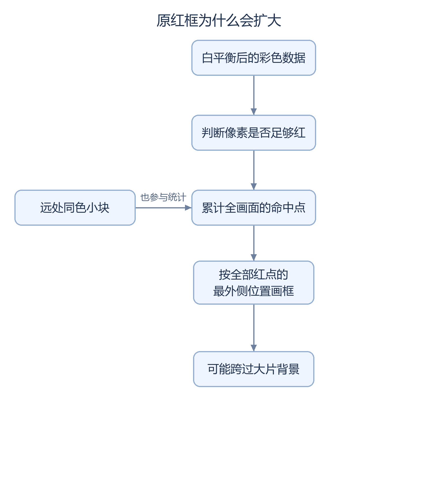

# SC520CS 原红色区域检测设计与验证报告（2026-10-17）

原红色候选在 Logo 版本上增加颜色统计、黄色包围框和 `RED TARGET` 标签。模块自检与工具构建完成后，2026-10-17 的板级反馈和视频仍发现贴边时包围框异常扩展。原因是原算法对全画面红色命中取联合框，远处同色区域也会拉大边界；后续已建立独立[稳定性修复候选](SC520CS_RED_STABILITY_REPORT.md)。本页保留原算法及其失败记录。

## 问题背景与原因分析

检测模块筛选符合颜色条件的像素，以全帧命中坐标的最小值和最大值生成联合包围框。相离红区及远处噪点均参与坐标极值统计，可能导致包围框跨越背景。



<details>
<summary>流程图的可编辑源码</summary>

图形来源：[生成脚本](../scripts/render_doc_diagrams.py)中的 `red_original` 定义；使用 Pillow 和固定中文字体生成。

</details>

颜色条件默认为红色通道至少 144，并且分别比绿色、蓝色高至少 48；红点至少 160 个，连续 3 个完整帧才确认。它不判断物体形状和类别。

## 验证结果与适用范围

|项目|结果|证据范围|
|---|---|---|
|原算法与叠加测试|两种尺寸各 39 帧、2,909,421 项比较，0 错误|测试实现是否遵循原规则；原规则本身仍会合并远处红点|
|最终工具构建|已完成，setup/hold +0.008/+0.020 ns|setup 仅剩 8 皮秒余量；不是长时间可靠性证明|
|实物视频|约 31.28 秒，确认贴边包围框异常扩展|原候选该板级稳定性项为 fail，工具检查通过不改变此结论|
|修复后表现|另有新候选，2026-10-18 已收到上板反馈|实物改善与连续运行稳定性结论仍需记录，不能使用原版本结果替代|

以下保留原候选接口、SHA-256 和失败构建记录；实物状态均限定在对应日期与验证范围。移动目标坐标与显示帧尚未精确绑定，框可能滞后；旧 FIFO 无间隙帧首反例也继续保留。


2026-10-17 从已有上板成功反馈的 Logo 候选 `qa/sc520cs_logo_osd_trial_20261017` 新建 `qa/sc520cs_red_target_trial_20261017`。基线实际 bitstream 为 `run_bitgen_logo_checked/sc520cs_logo_osd.bit`，现场复核 SHA-256 为 `04DF31EBD4758E2076B895F29004A2E8B15CDDDA7885F37798408F05A3E0D23A`，1789539 字节；此前 Logo 报告的未上板状态属于当时记录。开发者反馈未独立绑定现场加载 SHA-256，且原红色候选 20 分钟实测结果仍待板级测试负责人补充记录。

## 候选来源、统计输入与算法

工程入口为候选内 `lab_ex1_mipi_hdmi/td_project/camera_to_dsi_display.al`，design_top_wrapper、PH1P35MDG324、Speed -3，TD 6.2.168116。73 条源记录全部解析到独立候选内，完整路径和 SHA-256 见 `red_source_manifest.json`；相对 Logo 工程只修改顶层/ISP 接线及 .al 清单，新增 `custom_red_detector.v`、`custom_red_overlay.v`。其他工程源记录字节一致，见 `source_delta.json`、`inheritance_check.json`。

统计输入为 A/B/C 白平衡选择后的 RGB888，在四模式处理之前并行读取；HDMI 面板、Logo 和标签不会反馈到检测器。默认条件为 R≥144、R-G≥48、R-B≥48，至少 160 个合格像素，并连续 3 个完整帧才确认。参数在构建时配置，无需新增按键。

所有合格像素共同形成一个包围框，算法不划分连通域，也不识别物体类别。因此，多块红区会被合并，同色噪点累计超过门限也可能触发检测。

检测结果经持有数据和请求/应答邮箱跨到 HDMI 像素域，在显示 VS 上升沿原子更新正结果与四个坐标。一个完整帧无足够红像素、异常行/帧、上游协议故障、复位或停流超时均清除；连续 4 个 HDMI VS 没有新结果也清除。恢复后重新确认，不继承旧框。最后 EOL 完成统计，经独立结果寄存级发布，不改变视频数据延迟。每拍 4 像素先并行求左右端点和红像素个数，再更新一次统计，避免四级比较/加法串接。

框为黄色、2 像素宽，文字为 RED TARGET，(192,16)、120×14；框线跳过左上 160×208 诊断面板与右上安路 Logo 范围 (1088,16)..(1247,175)。在 mixer 后、原诊断面板与 Logo 前新增 1 个像素寄存级，DE/HS/VS/RGB 同延迟；原面板 3 级、Logo 3 级。输出为 1280×720，总时序 1650×750。

接口信号、域、端点和故障策略见候选 RED_CONTRACT.md（本地证据：`qa/sc520cs_red_target_trial_20261017/RED_CONTRACT.md`）。结果源自已完成的摄像头帧，经邮箱和后续显示帧才呈现；该阶段未把元数据绑定 DDR 帧槽，不声称与显示帧精确对应，移动目标存在滞后。

室内 AE、A/B/C、默认 RGB/A、短按切四模式及长按切 A/B/C 的行为不变，暂停 AE/AWB 调参。MIPI/DDR/HDMI IP、引脚、PLL、原时钟/复位/FIFO 修复保持。该构建阶段未执行硬件下载或 Flash 写入，不修改 release/current.json。

## 测试激励与回归结果

ModelSim 2020.3 运行独立逐像素整帧参考与像素叠加参考，覆盖小图及实际 1280×720、出现/消失、移动、四边/角落、小噪点、多块红区、阈值边界、最小像素数前一值/等值/后一值、逐帧精确红像素计数、全红最大计数、EOL 两种位置、四模式帧中请求、短行、视频停流、故障、启动/帧中复位和恢复、异步邮箱一致性、原子更新、字形和保护区逐像素检查。

原始小图/全分辨率自检均通过；新增结果寄存级及并行统计后分别重新执行，最终证据以 `tmp_red_modelsim_release3_small/full`、`final_unit_binding.json` 为准。每个几何版本 **39 帧、2909421 项检查、0 错误**，包含三个无行/帧间隙的连续帧。检测器无间隙检查不代表旧 FIFO 丢字反例已解决。Logo 自检也重新执行：3795937 项检查、27482 不透明/85158 透明命中、错误 0，见 `tmp_logo_modelsim/stdout.txt`。

ModelSim 在沙箱遇到系统 DLL 重定位错误，改用宿主运行；首轮复位刺激残留 SOF 的错误及修正记录保留，不计为功能通过。上述仿真不等于完整加密 DDR/HDMI PHY 仿真，更不等于实物验收。继承回归仍按各原测试的 force、数值模型和厂商库边界解释，旧无间隙 SOF/FIFO 丢字反例保持披露。

## 检测路径时序违例与修复

`syn_1` 在受限环境未完成；宿主 clean `syn_2` 完成，首轮 `run_route_1` 完成，该轮网表精确入口审查后 SWNS=-1.307 ns、STNS=-41.569 ns、HWNS=+0.020 ns，44 条真实检测 setup 违例，禁止用于交付 bitstream。`first_route_violation_summary.txt`、`run_query_first_diag` 保存原始证据。

依据实际路径先新增独立结果寄存级，clean `syn_3` 和 `run_route_2` 保留作对照；再对仍串接的每拍统计做并行端点/计数归约，该候选最终 clean 综合为 `syn_4`。两版旧 RTL 及输入 SHA-256 分别在 `experiments/before_result_stage`、`experiments/before_parallel_extrema`，不覆盖失败证据。

原时钟保持 CSI/MIPI_RX_BYTE_CLK 9.660 ns、HDMI_PIXEL_CLK 13.333 ns。CDC 仅精确限定已证明的首级 D/原始复位捕获入口，新增 51 个实际存活邮箱位沿用 12 ns 包络数据预算；灰码仍要求 36/36 条、7.2 ns，AE/按键仍保留原 8 ns。对该轮实际打包位置重新定位并核查，不复用旧 packed pin，也不增加 blanket cut。最终网表与 bitgen 结果见下表；所有预算保持，未用放宽时钟或既有预算消除违例。

## 板级反馈的时间范围

在 2026-10-17 构建完成时，原红色候选实物、20 分钟连续运行稳定性、Flash、冷启动均为 **not tested**。其后视频确认了边界异常扩展，按本报告的问题背景登记，未补写完整验收通过。按候选 BOARD_TEST_GATE.md（本地证据：`qa/sc520cs_red_target_trial_20261017/BOARD_TEST_GATE.md`） 手动核对最终 bitstream SHA-256，后续只按开发者反馈登记结果。


## 最终构建、资源与文件指纹

最终构建链：`syn_4 → run_route_3 → run_route_4_postopt → final → run_bitgen_red_checked`。全部为新运行；没有增量沿用 Logo 的 gate/db 作为本候选综合结果。post-route 优化尝试未改善 setup 裕量，仍如实保留 8 ps；不能据此宣称稳健板级签核。

|检查|实际结果|证据（候选内）|
|---|---|---|
|clean 综合/布局布线/bitgen|pass；各进程退出 0，完整生成标记和数据库/bitstream 存在|syn4_runner.txt、run_route_3、run_route_4_postopt、run_bitgen_red_checked|
|最终 setup/hold|pass（建模范围）；SWNS **+0.008 ns**、STNS 0；HWNS **+0.020 ns**、HTNS 0|bitgen_sta_status.txt、bitgen_sta_all.timing；bitgen 当场重载最终精确约束并重算|
|建模覆盖率|**98.91%**；外部 I/O/PLL/硬 PHY/加密 DDR、MTBF 和板级验证仍不完整|bitgen_sta_all.timing、bitgen_check_timing.txt|
|灰码预算|36/36，原 7.2 ns；最小 slack **+6.023 ns**|final_diag_gray36.tsv|
|新增检测邮箱|51 个实际存活位，原型 12 ns 预算；最小 **+11.039 ns**；逐位源/捕获端、唯一跨域捕获、首级同步器和复位链证明通过|red_bundle_mapping.tsv、red_entry_scope.tsv、final_red_bundle_checked.tsv|
|原诊断/AE/按键约束|177 位诊断 bundle 最小 +10.998 ns；170 组原下游检查保持；AE/手势 8 ns 原预算保持，后级未 blanket cut|final_audit_diag_reports.py.txt、final_audit_closed_reports.py.txt、final_audit_awb_reports.py.txt|
|检测专项/官方 Logo|pass；两种几何各 39 帧/2909421 项，Logo 3795937 项；错误均 0|tmp_red_modelsim_release3_small/full、tmp_logo_modelsim、final_unit_binding.json|
|相关既有回归|pass；14 组，另对最终统计 RTL 重跑实际顶层 AE 三场景；normal 13 帧/29 项，nack 2 帧/9 项，update_nack 13 帧/16 项，错误均 0|logo_regression_status.txt、red_regression_final.json、closed_ae_actual_top_final_evidence.txt|
|数值/厂商模型边界|Icarus 12.0 devel 及 ModelSim 2020.3；AWB arithmetic_full 使用已验证的 divider 数值模型，gate_short 使用实际门级 divider/TD RAM；425 条既有 IP 告警保留|awb_arithmetic_full_pure_evidence.txt、awb_gate_short_evidence.txt；四模式链路保留 -i/force 的厂商 IP 边界|
|输入与实测证据对应|79 项编译记录（7 个目录）、73 条工程源及 syn_4 全部输入 SHA-256 与该候选源码一致；旧统计版本的 AE 证据另存，最终版本单独重跑|red_test_binding_result.txt、red_source_manifest.json、syn_4_input_hashes.json|
|原文件/暂存区保护|7113 个 project/vendor/Logo 重点文件大小与 SHA-256 全一致；Git 暂存区一致；阶段基线 394 项依赖检查/0 错误，原成功 bitstream 保留|protection_after.json、baseline_verify_current.txt、staged_before.txt|

最终物理资源（同口径 route.area）：

|资源|Logo 基线|检测候选|增量|
|---|---:|---:|---:|
|LUT6|16715|17234|+519|
|REG|17434|17823|+389|
|Slice|18385|18922 / 21216（89.19%）|+537|
|ERAM|42|42|0|
|DSP|17|17|0|

最终综合保留 123 条可见告警，未发现引用新增红区模块的告警。HDL-5369、未连接/未驱动、RAM_STYLE 等继承问题见 red_synthesis_warnings.txt；clean 仅表示重新综合。最终 setup 只剩 +8 ps，长期稳定性仍需独立板测。

- bitstream：sc520cs_red_target.bit（本地证据：`qa/sc520cs_red_target_trial_20261017/run_bitgen_red_checked/sc520cs_red_target.bit`），**1789539 字节**。
- SHA-256：`7EBEC0062FF9966BEE76C043D831031FC9B09AD24DB62E0C34F08D781E289FFE`。
- 清单：bitstream_manifest.json（本地证据：`qa/sc520cs_red_target_trial_20261017/run_bitgen_red_checked/bitstream_manifest.json`）；汇总 red_release_summary.json；关键证据 SHA-256 见 red_release_evidence_manifest.csv。
- 工程与所有原候选、原成功 bitstream 保留；未修改 project/vendor，未下载、未写 Flash；release/current.json 仍保留原阶段演示基线。

构建记录入口（仓库根执行；脚本拒绝覆盖已有目录，复现应使用独立候选与新运行名）：

```powershell
powershell -NoProfile -ExecutionPolicy Bypass -File qa/sc520cs_red_target_trial_20261017/run_red_modelsim.ps1 -Full
powershell -NoProfile -ExecutionPolicy Bypass -File qa/sc520cs_red_target_trial_20261017/run_logo_regressions.ps1
powershell -NoProfile -ExecutionPolicy Bypass -File qa/sc520cs_red_target_trial_20261017/run_opt_gate.ps1 -RunName syn_4
powershell -NoProfile -ExecutionPolicy Bypass -File qa/sc520cs_red_target_trial_20261017/run_implement.ps1 -RunName run_route_3 -SynRun syn_4
powershell -NoProfile -ExecutionPolicy Bypass -File qa/sc520cs_red_target_trial_20261017/run_physical_diag_trial.ps1 -InputRoute run_route_3 -RunName run_route_4_postopt -Operation post_opt
powershell -NoProfile -ExecutionPolicy Bypass -File qa/sc520cs_red_target_trial_20261017/run_current_audit.ps1 -Route run_route_4_postopt -Prefix final
powershell -NoProfile -ExecutionPolicy Bypass -File qa/sc520cs_red_target_trial_20261017/run_red_bitgen.ps1 -Route run_route_4_postopt -Prefix final
```

板级验证计划：板级测试负责人后续核对 SHA-256 并手动加载 SRAM；用红纸进出/移动，检查出现、消失、四边、噪点和两块红纸联合框；短按走完四模式、长按 A/B/C；有框时复位并检查视频恢复无旧框；最后记录带 SHA-256 的 20 分钟观察。上述为板级验证计划，未执行项保持 not tested。
